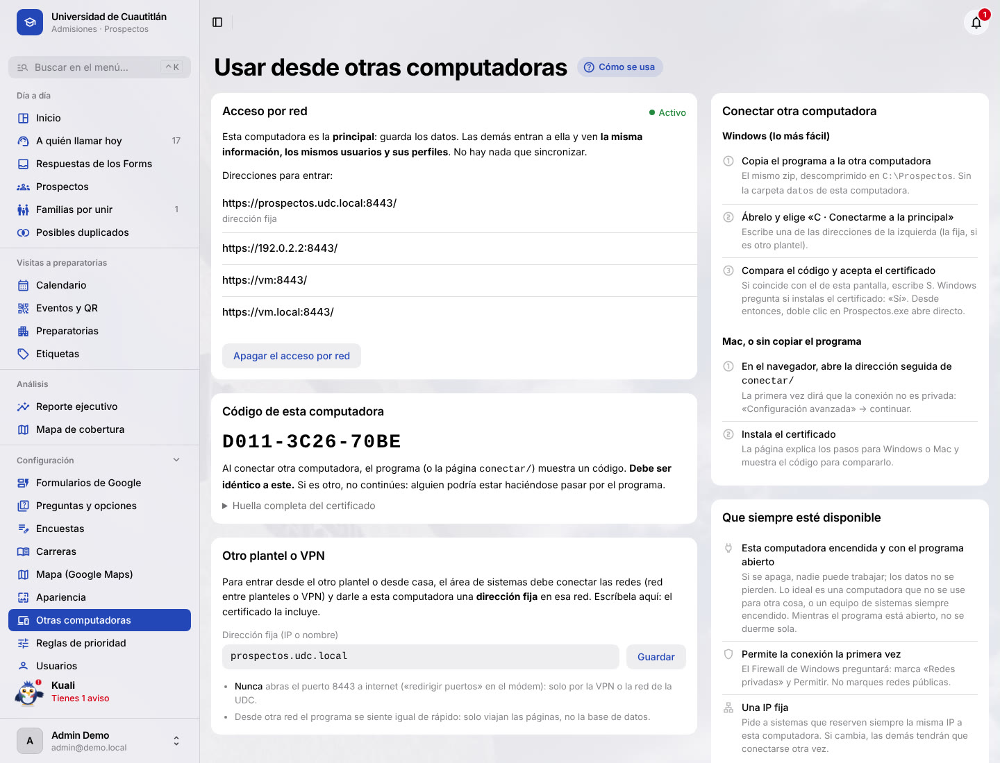
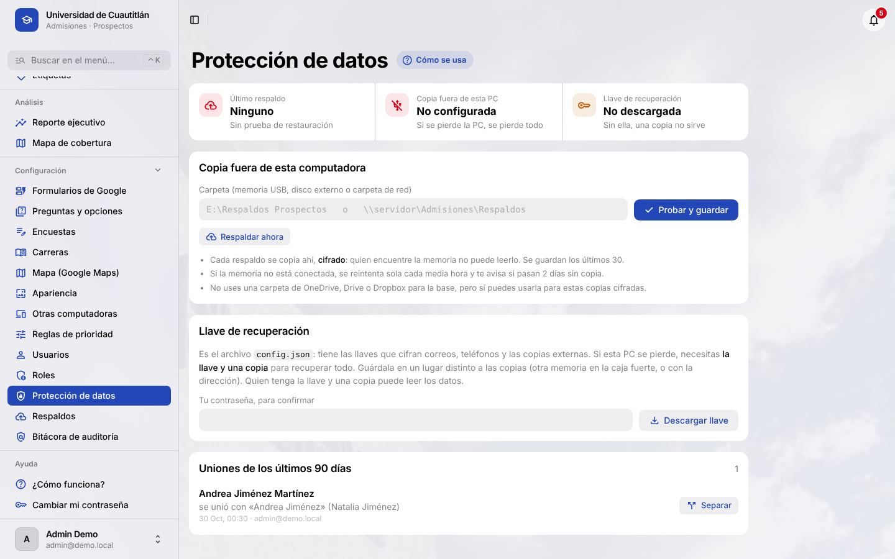
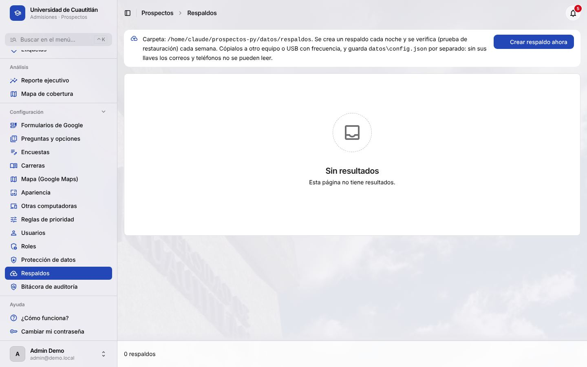

# Prospectos · Manual de instalación y operación

**Para:** la persona que instala el programa, crea usuarios, cuida los respaldos y lo actualiza.
**Versión del programa:** 1.0.0 (octubre de 2026). © 2026 NullSpace Studio.

---

## 1. Cómo está armado (lo mínimo que hay que entender)

- **Una sola computadora corre el programa**: la «PC del sistema» de Admisiones. Ahí viven la base de
  datos, las llaves y los respaldos, en la carpeta `datos` junto a `Prospectos.exe`.
- Mientras su **ventana negra** esté abierta, el programa importa las respuestas de Google cada minuto,
  crea las llamadas pendientes, genera los avisos y hace los respaldos. Si la ventana está cerrada, nada
  de eso pasa; al volver a abrirla se pone al día.
- Las demás computadoras **no instalan nada**: entran con el navegador por la red de la oficina
  (sección 6). Si instalas el programa en otra PC, tendrá datos separados.
- Sale a internet solo para: Google Forms, el correo (si se configura), y el mapa. El asistente no usa internet.

**Requisitos de la PC del sistema**

| Qué | Mínimo |
|---|---|
| Sistema | Windows 10 u 11 de 64 bits (también hay versión para Mac con chip Apple) |
| Memoria y disco | 4 GB de RAM; 2 GB libres (los respaldos crecen con el tiempo) |
| Cuenta de Windows | Con contraseña y solo para Admisiones |
| Disco | **BitLocker activado** (recomendado: los nombres de la base no van cifrados) |
| Encendido | Prendida en horario de oficina y, de preferencia, en las tardes de visitas |
| Para la copia externa | Una memoria USB o disco externo dedicado, o una carpeta de red |

## 2. Instalar

1. Descomprime `Prospectos-windows.zip` en **`C:\Prospectos`**. No lo dejes en Descargas, en el
   Escritorio sincronizado ni en OneDrive: la base se daña si se sincroniza mientras está abierta.
2. Doble clic en `Prospectos.exe`. Si Windows dice «Windows protegió su PC», elige **Más información →
   Ejecutar de todas formas**. El programa no está firmado digitalmente, por eso avisa.
3. La primera vez pregunta el papel de la computadora: **P · Principal** (aquí se guardan los datos; solo
   una) o **C · Conectarme a la principal** (sección 6.3). En la principal, después pide crear el
   **administrador**: tu correo y una contraseña de 12 caracteres o más.
   Al entrar te pide activar la **verificación en 2 pasos** (sección 5): ten a la mano tu teléfono con
   Google Authenticator o Microsoft Authenticator.
4. Se abre el navegador en `http://127.0.0.1:8000/admin/`. **Deja abierta la ventana negra.** Para
   apagar el programa, ciérrala.

> **Recomendado:** primero haz una instalación de prueba en `C:\ProspectosPrueba`, con tus Forms y
> respuestas reales. Cuando todo cuadre, borra esa carpeta e instala la definitiva. El paso a paso
> detallado está en el anexo A.

## 3. Primeros pasos con datos reales

El Inicio del administrador muestra una lista de **Primeros pasos** hasta que todo está configurado:

1. **Conectar Google** (anexo B): una cuenta de servicio, o tu propia cuenta de Google si la universidad
   no permite compartir el Form con una cuenta de servicio.
2. **Registrar los Forms** del alumno y de la familia.
3. **Revisar el mapeo**: que cada pregunta del Form corresponda a la del programa.
4. **Ubicar los planteles y las prepas** en el mapa.
5. **Crear los usuarios** (sección 5).
6. **Configurar la protección de datos** (sección 7). No lo dejes para después.
7. **Para capacitar** sin tocar los datos reales, usa otra carpeta (por ejemplo `C:\Capacitacion`) y ahí
   ejecuta `Prospectos.exe demo`: carga aspirantes ficticios (usuario `admin@demo.local`, contraseña
   `Demo-Prospectos-2026!`). El programa se niega a cargar la demostración en una carpeta que ya tiene
   usuarios o respuestas reales.

## 4. Configuración del archivo `datos\config.json`

Se crea solo al primer arranque. Lo que se puede cambiar (con el programa cerrado):

| Clave | Para qué | Por omisión |
|---|---|---|
| `PUERTO` | Puerto local | 8000 |
| `IMPORTADOR_CADA_MINUTOS` | Cada cuánto trae respuestas de Google | 1 |
| `CORREO` | Servidor de correo para las bienvenidas (HOST, PUERTO, USUARIO, CLAVE, TLS) | vacío (no envía) |
| `CUARENTENA_DIAS` | Días que un menor espera el permiso antes de borrarse | 30 |
| `RETENCION_MESES` | Meses sin actividad antes de anonimizar | 18 |
| `DIAS_SIN_CONTACTO` | Días sin contacto antes de crear una llamada pendiente | 5 |
| `RESPALDO_HORA` | Hora del respaldo diario (si la PC está apagada a esa hora, se hace al abrir el programa) | 02:30 |
| `RESPALDO_DIAS_RETENCION` | Días que se guardan los respaldos en la PC | 14 |
| `INACTIVIDAD_MINUTOS` | Minutos sin uso antes de cerrar la sesión (0 lo apaga) | 30 |

**No cambies ni compartas** `SECRET_KEY`, `CLAVE_CIFRADO` ni `CLAVE_INDICE_CIEGO`. Si se pierden, los
correos, los teléfonos y las copias externas **no se pueden leer nunca más**.

## 5. Usuarios y roles

**Configuración → Usuarios → Agregar:** correo, nombre, rol y, para los promotores, su código de
promotor. La contraseña temporal se muestra **una sola vez**: entrégala en persona. La persona debe
cambiarla al entrar.

| Rol | Para quién |
|---|---|
| Administrador | 1 o 2 personas: usuarios, respaldos, protección de datos, bitácora |
| Coordinación | Jefatura de Admisiones: preguntas, carreras, reglas de prioridad, usuarios |
| Admisiones | Asesores que llaman y dan seguimiento |
| Promotor | Quien va a las prepas: sus eventos y sus aspirantes, con el contacto oculto |
| Directivo | Rectoría y dirección: cifras, mapa y reporte, sin datos personales |

- Los usuarios **no se borran, se desactivan**, para que la bitácora conserve quién hizo qué.
- **Una cuenta por persona.** No compartan contraseñas: la bitácora registra quién vio cada teléfono.
- **5 contraseñas equivocadas** bloquean el usuario 15 minutos. Restablecer la contraseña lo desbloquea
  al entrar con la nueva.
- **Verificación en 2 pasos:** obligatoria para administradores (se configura al entrar por primera vez),
  opcional para los demás. La columna **2 pasos** de la lista de usuarios muestra quién la tiene.
  - Si alguien perdió su teléfono y sus códigos de recuperación: selecciónalo en la lista → acción
    **Quitar la verificación en 2 pasos**. Queda en la bitácora.
  - Si el **único administrador** la perdió: en la PC del programa, abre una ventana de comandos en la
    carpeta y ejecuta `Prospectos.exe quitar_dos_pasos correo@udc.mx`. Por eso la PC del programa debe
    estar en un lugar con acceso controlado.
  - Para apagar la obligación (no recomendado), en `datos\config.json`: `"DOS_PASOS_ADMINS": false`.
- **Cuentas de demostración** (`@demo.local`): dejan de poder entrar en cuanto existe un administrador
  real, aunque nadie haya borrado la demostración.

## 6. Varias computadoras y planteles



Una sola computadora es la **principal**: guarda la base de datos. Las demás **se conectan** a ella con el
navegador y ven la misma información, los mismos usuarios y sus perfiles. No hay sincronización: es una
sola base.

> **No instales el programa con datos en cada computadora.** Cada una tendría sus propios aspirantes,
> usuarios y llaves de cifrado, y no se pueden juntar después.

### 6.1 En la principal

1. **Configuración → Otras computadoras → Activar el acceso por red**. Cierra y vuelve a abrir el programa.
2. Si Windows pregunta por el firewall, permite a Prospectos en **Redes privadas** (no públicas).
3. Pide a sistemas una **IP fija** para esta computadora.
4. Activa **Abrir al iniciar sesión** para que, tras un reinicio, el programa se abra solo en cuanto alguien
   inicie sesión. Lo ideal es que la principal sea una computadora que no se apague ni se use para otra cosa.
5. Anota el **código de esta computadora** (por ejemplo `D011-3C26-70BE`): se compara al conectar las demás.

### 6.2 Otro plantel o desde casa

El programa no se abre a internet. Para entrar desde otra red:

1. Sistemas conecta los planteles (red entre planteles) o da una **VPN** a quien la necesite.
2. Sistemas te da la **dirección fija** con la que se llega a la principal desde esa red (una IP como
   `10.20.1.15` o un nombre como `prospectos.udc.local`).
3. Escríbela en **Otras computadoras → Otro plantel o VPN** y reinicia el programa: el certificado se
   renueva solo con esa dirección.
4. Recomendado: **Pedir la verificación en 2 pasos a todos** (misma pantalla).

**Nunca** «redirijas el puerto 8443» en el módem para entrar desde internet: los datos de menores quedarían
expuestos a cualquiera que adivine una contraseña.

### 6.3 Conectar una computadora

**Windows:** copia la carpeta del programa **sin** la carpeta `datos`, ábrelo y elige
**C · Conectarme a la principal**. Escribe la dirección, compara el código con el de la principal y, si es
igual, escribe **S**; Windows pregunta si instalas el certificado: **Sí**. Desde entonces, doble clic en
`Prospectos.exe` comprueba que la principal responda y abre el navegador ahí. Si la principal está apagada,
lo dice y reintenta durante 2 minutos. Para cambiar de principal: `Prospectos.exe conectar`.

**Mac, o sin copiar el programa:** en el navegador abre `https://<dirección>:8443/conectar/`, compara el
código, descarga e instala el certificado siguiendo los pasos de esa página.

> Si Firefox sigue mostrando el aviso de seguridad (usa sus propios certificados), usa Edge o Chrome.

## 7. Protección de datos (obligatorio antes de usar datos reales)



En **Configuración → Protección de datos** (solo administradores):

### 7.1 Copia fuera de esta computadora
1. Conecta una memoria USB o disco externo **solo para esto** (o usa una carpeta de red) y crea una
   carpeta, por ejemplo `E:\Respaldos Prospectos`.
2. Escribe la ruta y pulsa **Probar y guardar**. Se copia el último respaldo en ese momento.
3. Desde entonces, cada respaldo diario se copia ahí **cifrado** y se conservan los últimos 30. Si la memoria
   no está conectada, se reintenta cada media hora y la campanita avisa si pasan 2 días sin copia.

### 7.2 Llave de recuperación
1. En la misma pantalla, escribe tu contraseña y pulsa **Descargar llave** (es el `config.json`).
2. Guárdala en un lugar **distinto** a las copias: otra memoria en la caja fuerte, o con la dirección.
   Queda registrado quién la descargó y cuándo.

> La copia sin la llave no sirve, y la llave junto con la copia permite leer todo. Por eso van separadas.

### 7.3 Separar uniones equivocadas
En **Uniones de los últimos 90 días** se ven las fichas que se unieron, y las sospechosas en rojo
(por ejemplo, nombres de otro sexo como Fernanda y Fernando). **Separar** las vuelve dos fichas y evita que
se unan solas otra vez.

## 8. Respaldos



- **Diario**, a la hora de `RESPALDO_HORA`, en `datos\respaldos`, o al abrir el programa si el último
  tiene más de 24 horas.
- **Prueba de restauración semanal automática**: el programa abre el respaldo en un lugar aparte y cuenta
  los registros. La fecha de la última prueba se ve en Protección de datos.
- **Antes de actualizar:** si una versión nueva cambia la base, se guarda sola una copia
  `prospectos-antes-de-actualizar-…`.
- **Manual:** *Respaldar ahora* en Protección de datos, o `Prospectos.exe respaldo crear`.

## 9. Actualizar a una versión nueva

1. **Cierra la ventana negra.**
2. Descomprime la versión nueva **encima** de `C:\Prospectos` y deja que Windows reemplace los archivos.
3. **No borres la carpeta** antes de descomprimir: dentro está `datos`, con toda la información.
4. Abre `Prospectos.exe`. Si la versión trae cambios a la base, la ventana negra muestra
   «Copia previa: prospectos-antes-de-actualizar-…».
5. Entra y revisa que el Inicio muestre tus cifras de siempre.

Si algo sale mal, restaura la copia previa (sección 10) y avisa a NullSpace Studio.

## 10. Restaurar o recuperar

### En la misma computadora (por ejemplo, después de un error)
1. Cierra la ventana negra.
2. En `C:\Prospectos`, clic derecho → *Abrir en Terminal*:
   ```
   .\Prospectos.exe respaldo listar
   .\Prospectos.exe respaldo restaurar prospectos-AAAAMMDD-HHMMSS.sqlite3.gz
   ```
3. Escribe `RESTAURAR` para confirmar. Antes de reemplazar la base, el programa guarda una copia de cómo
   estaba.

### En una computadora nueva (la anterior se perdió o se dañó)
1. Descomprime el programa en `C:\Prospectos` y ábrelo una vez. Cuando pida crear el administrador, cierra la ventana.
2. Copia la **llave de recuperación** (`config.json`) dentro de `C:\Prospectos\datos`, reemplazando la que
   se creó.
3. Conecta la memoria con las copias y, en una terminal dentro de `C:\Prospectos`:
   ```
   .\Prospectos.exe respaldo restaurar "E:\Respaldos Prospectos\prospectos-AAAAMMDD-HHMMSS.sqlite3.gz.cifrado"
   ```
4. Abre `Prospectos.exe` normalmente. Si usaban Google con cuenta de servicio, copia también su archivo
   `.json` a `datos`.

> **Practícalo una vez al año** en una PC de prueba. Un respaldo que nunca se ha restaurado no es un
> respaldo confiable.

## 11. Rutina

| Cada… | Qué | Dónde |
|---|---|---|
| Día | Que la ventana negra esté abierta; revisar la campanita | PC del sistema |
| 2 veces por semana | Familias por unir y Posibles duplicados | Admisiones |
| Semana | Que «Copia fuera de esta PC» diga **Al día**; si se usa una sola memoria, llevarla a otro lugar | Protección de datos |
| Mes | Revisar la **Bitácora**: exportaciones con contacto, bloqueos de acceso, descargas de la llave | Configuración → Bitácora |
| Mes | Desactivar a quien ya no trabaja en Admisiones | Usuarios |
| Semestre | Revisar con jurídico el aviso de privacidad y los plazos de retención | — |
| Año | Prueba de recuperación completa en otra computadora (sección 10) | — |

## 12. Si algo falla

| Síntoma | Qué hacer |
|---|---|
| No llegan respuestas | ¿Está abierta la ventana negra? Luego Formularios → columna *Estado*. Error 403: el Form no está compartido con la cuenta de servicio. 404: se pegó la URL pública en vez de la de edición. |
| Aviso «Falló el respaldo» | Espacio en disco. Libera espacio y pulsa *Respaldar ahora*. |
| Aviso «La copia fuera de esta PC no se ha hecho» | Conecta la memoria o revisa la carpeta de red; se reintenta sola. |
| «Windows protegió su PC» | *Más información → Ejecutar de todas formas*. |
| El navegador no se puede conectar | Se cerró la ventana negra: vuelve a abrir `Prospectos.exe`. |
| Otra computadora: «La conexión no es privada» | Falta instalar el certificado (sección 6). Si ya estaba, alguien borró `datos\red`: vuelve a instalarlo. |
| Otra computadora no abre nada | ¿Está abierto el programa en la PC del sistema? ¿Cambió su IP? ¿El firewall lo permite en redes privadas? |
| Un usuario no puede entrar | Bloqueo de 15 minutos por intentos fallidos, o usuario desactivado. Restablécele la contraseña. |
| La base se dañó | Restaurar el último respaldo (sección 10). |

Errores que no estén aquí: anota el mensaje exacto de la ventana negra y avisa a NullSpace Studio.

---

## Anexo A. Puesta en marcha paso a paso

El documento `docs/puesta-en-marcha.md` va incluido en la carpeta del programa.

## Anexo B. Conectar los Google Forms

El documento `docs/formularios.md` va incluido en la carpeta del programa.

## Anexo C. Base de datos en MariaDB (opcional)

El documento `docs/mariadb.md` va incluido en la carpeta del programa. Solo hace falta si la base debe vivir
en un servidor. Requiere MariaDB 10.11 o mayor.

## Anexo D. Seguridad y datos personales

El documento `docs/seguridad.md` va incluido en la carpeta del programa. Describe qué se cifra, quién ve qué,
la bitácora, la retención y los riesgos que debe decidir la institución.
