# Prospectos · Manual de usuario

**Para:** Admisiones, coordinación, promotores y directivos de la Universidad de Cuautitlán.
**Versión del programa:** 1.0.0 (octubre de 2026). © 2026 NullSpace Studio.

Este manual explica cómo usar el programa día a día. Para instalarlo, respaldarlo o actualizarlo, ver el
*Manual de instalación y operación*. Dentro del programa, **Ayuda → ¿Cómo funciona?** tiene las mismas
guías, y cada pantalla tiene un botón **Cómo se usa** que abre la suya.

---

## 1. Qué hace el programa, en una frase

Junta las respuestas de los Google Forms que contestan los aspirantes y sus familias en las visitas a
preparatorias. Une al alumno con su familia, decide a quién llamar primero y lleva el seguimiento hasta
la inscripción, cuidando los datos de los menores.

El camino de una respuesta:

1. El alumno escanea el **QR** de la visita y contesta el Form. Su familia contesta el suyo.
2. En menos de 2 minutos el programa la trae, siempre que esté abierto en la PC de Admisiones.
3. Si es **menor de edad**, espera el **permiso** de su familia antes de poder usarse.
4. Se une con la respuesta de su familia, recibe una **prioridad de 0 a 100** y entra a **A quién llamar hoy**.
5. Un asesor lo contacta, registra la llamada y lo lleva por el embudo: Contactado → Open house →
   Solicitó inscripción → Inscrito.

## 2. Entrar

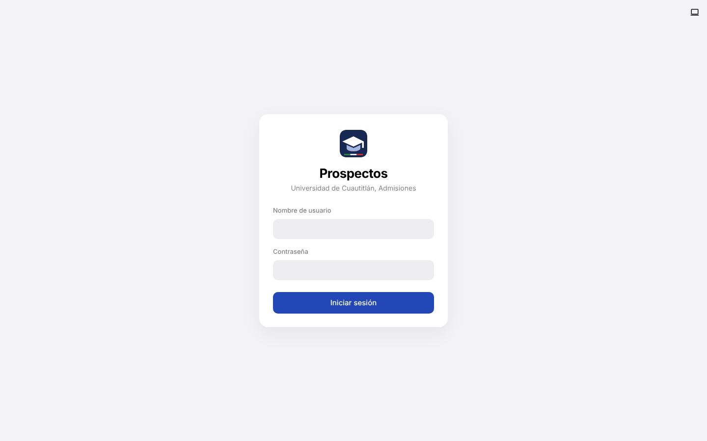

- Entra con tu correo y contraseña. La primera vez el programa te pide cambiar la contraseña temporal
  por una tuya de **12 caracteres o más**.
- **5 contraseñas equivocadas** bloquean tu usuario 15 minutos. Si se te olvidó, un administrador te
  la restablece.
- Si pasas **30 minutos sin usar** el programa, o cierras el navegador, la sesión se cierra sola. Es para
  que una computadora abierta no deje a la vista los datos de los aspirantes.

**Qué ve cada rol**

| Rol | Ve y hace |
|---|---|
| **Administrador** | Todo, incluidos usuarios, respaldos, protección de datos y bitácora. |
| **Coordinación** | Lo de Admisiones, más preguntas, carreras, reglas de prioridad y usuarios (que no sean administradores). |
| **Admisiones** | A quién llamar, fichas con contacto, seguimiento, familias, duplicados, eventos y exportar. |
| **Promotor** | Sus eventos, QR, tarjetas, la pantalla En vivo y sus aspirantes, con el contacto oculto. |
| **Directivo** | Inicio, mapa y reporte ejecutivo: solo cifras, sin datos personales. |

## 3. Inicio

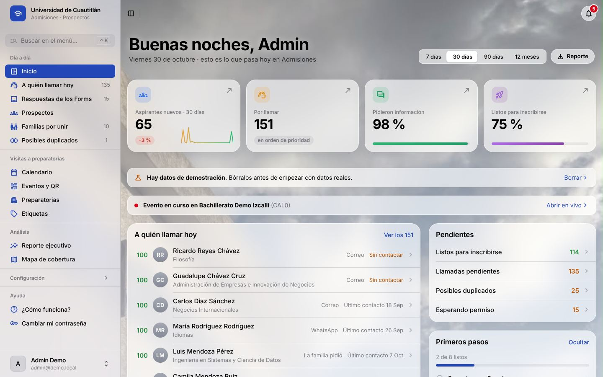

- Arriba, cuatro cifras del periodo elegido (7 días, 30 días, 90 días o 12 meses): **aspirantes
  nuevos**, **por llamar**, **% que pidió información** y **% listos para inscribirse**. Cada tarjeta lleva a
  su lista.
- Avisos amarillos o rojos si algo requiere atención: un evento en curso, datos de demostración o un Form
  que no se pudo leer.
- **A quién llamar hoy**: los primeros de la lista. **Pendientes**: cuántos hay en cada lista de trabajo.
- **Reporte** descarga el resumen del periodo.

## 4. Avisos (la campanita)

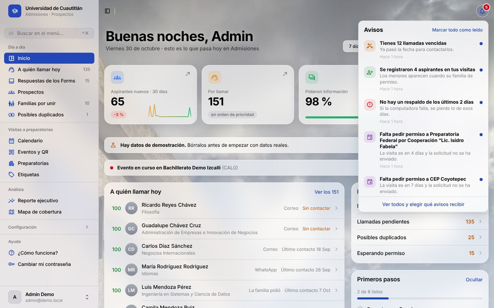

Arriba a la derecha. El número rojo indica cuántos avisos no has leído.

| Aviso | Cuándo llega |
|---|---|
| **Aspirantes nuevos** | Cuando alguien te asigna uno, o cuando se registran con tu código o QR. Se juntan en uno solo mientras no lo abras. |
| **Llamadas vencidas** | Un aviso al día con la cifra («Tienes 12 llamadas vencidas»). |
| **Visitas** | Un día antes de cada visita (con cuántas cartas de beca llevar), y si a una semana aún no se pide permiso a la prepa. |
| **Problemas del sistema** | Solo administradores: respaldo que falló, copia externa sin hacer, Form que no se pudo leer. No se pueden apagar. |

- Al abrir un aviso, te lleva a lo que hay que hacer y se marca como leído.
- En **Ver todos** eliges qué avisos recibir.
- Los avisos no muestran nombres ni teléfonos y se borran solos a los 60 días.

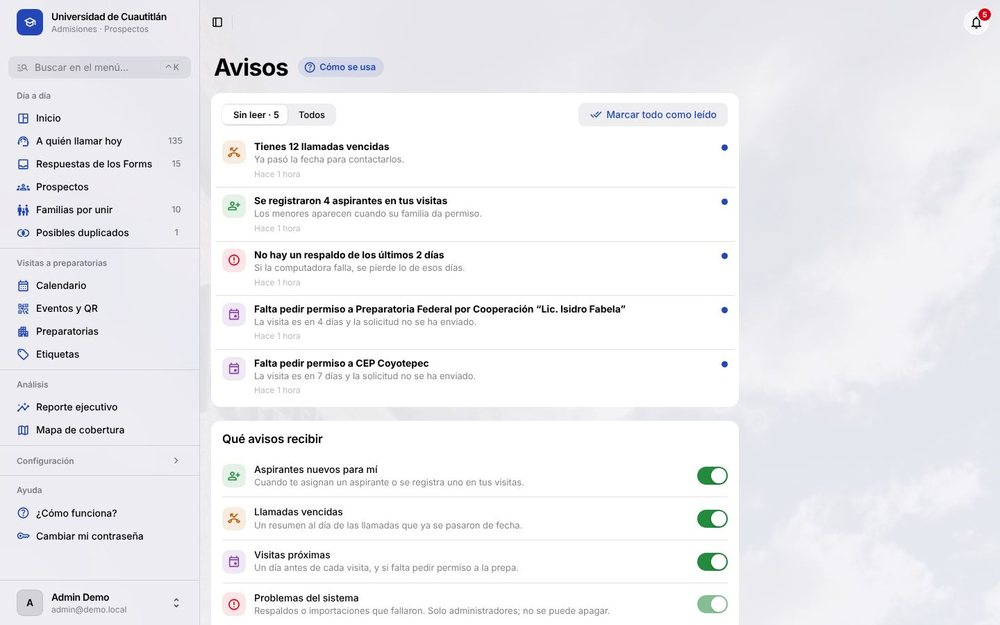

## 5. A quién llamar hoy

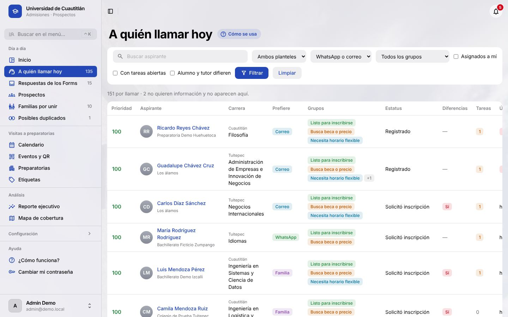

1. La lista está ordenada por **prioridad**. Entre dos con la misma prioridad va primero quien lleva más
   tiempo sin contacto.
2. Filtros: *Asignados a mí*, *Con tareas abiertas*, por grupo («Listo para inscribirse», «Sensible a
   beca»…) o *con diferencias entre el alumno y su familia*.
3. Abre la ficha (siguiente sección), contacta y registra lo que pasó.

Quien contestó **«No, gracias»** a recibir información no aparece aquí y **no se le llama**.

## 6. La ficha del aspirante

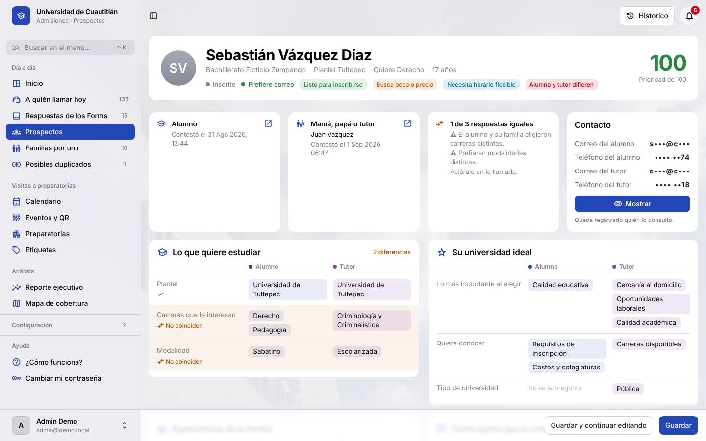

- **Arriba:** nombre, prepa, prioridad (de 0 a 100) y estatus.
- **Alumno / Familia / Coincidencias:** si contestó el alumno, si contestó su familia y en qué no están
  de acuerdo. Por ejemplo, si el alumno quiere Derecho y la familia Ingeniería, la llamada es distinta.
- **Respuestas por tema**, con el alumno y la familia lado a lado. Las que no coinciden se marcan en ámbar.
- **Contacto:** el correo y el teléfono aparecen ocultos. **Mostrar** los revela y deja registro de quién
  los vio.
- **Registrar contacto o nota:** el tipo (llamada, WhatsApp, correo, visita o nota interna), la fecha y lo que
  se habló. El primer contacto real pasa al aspirante a *Contactado* y cierra sus llamadas pendientes. Una
  nota interna no cuenta como contacto.
- **Estatus:** cámbialo conforme avance: Contactado → Asistió a open house → Solicitó inscripción →
  Inscrito, o Descartado.
- **Asesor:** asígnalo a alguien y esa persona recibe un aviso.
- Si pasan **5 días sin contacto**, el programa crea una llamada pendiente.

**Si la ficha junta a dos personas distintas** aparece el aviso «Esta ficha junta … respuestas» con el botón
**No es la misma persona: separar**. Las dos vuelven a ser fichas independientes y el programa ya no las
une solo. Un correo de bienvenida que ya se haya enviado no se puede deshacer.

## 7. Respuestas de los Forms: «contestaron y no aparece»

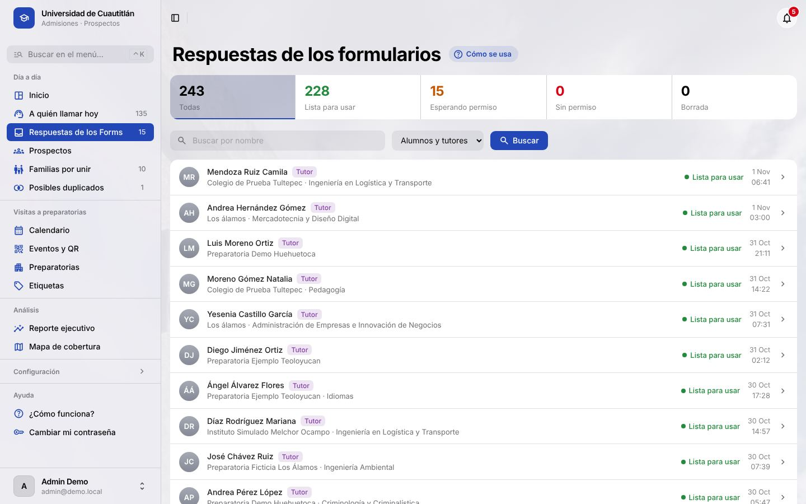

Aquí está **todo** lo que llegó, aunque todavía no se pueda usar:

| Estado | Qué significa | Qué hacer |
|---|---|---|
| **Lista para usar** | Ya está en Prospectos y en la lista de llamadas. | Nada. |
| **Esperando permiso** | Menor de edad, o no dijo su edad, sin el permiso de su familia. | Que la familia conteste su Form con el código de la tarjeta, o **Pedir el permiso del tutor** (abajo). Si en 30 días no llega, se borra. |
| **Sin permiso** | No aceptó el aviso de privacidad. | Nada: no se puede usar. |
| **Borrada** | Venció la espera o la persona pidió borrar sus datos. | Nada. |

**Pedir el permiso del tutor por teléfono:** abre la respuesta → *Pedir el permiso del tutor*. Llama
**solo para pedir el permiso**, explica el aviso de privacidad y, si acepta, registra el nombre del tutor
y el medio (llamada, WhatsApp, en persona, por escrito). Queda tu nombre, la fecha y el medio.

Si una respuesta **ni siquiera aparece aquí**: el programa estaba cerrado (se pone al día al abrirlo) o
el Form tiene un problema de conexión (aviso rojo en el Inicio).

## 8. Familias por unir

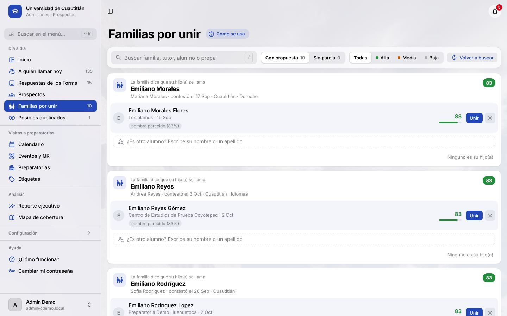

La encuesta de la familia y el cuestionario del alumno llegan por separado. Si el programa está seguro,
los une solo. Si duda, aparecen aquí: **una tarjeta por familia** con sus posibles hijos(as), el más
probable primero, con sus puntos y por qué se parecen.

- **Unir** en el correcto. La **✕** si ese no es. **Ninguno es su hijo(a)** si no es ninguno.
- **Buscador de arriba:** familia, tutor, alumno o prepa. No importan los acentos ni las variantes
  comunes («Jimena» encuentra «Ximena»). La tecla **/** lleva directo al buscador.
- **Alta / Media / Baja:** filtra por qué tan seguro está el programa (Alta: 60 puntos o más).
- **¿Es otro alumno?** dentro de la tarjeta: escribe el nombre del hijo(a) si no está entre las
  propuestas. Si no tiene nada en común con la familia, el botón pide un segundo clic para confirmar.
- **Sin pareja:** encuestas de familias que todavía no tienen ninguna propuesta. Si el alumno aún no
  contesta, déjala: se unirá sola cuando conteste.

> **Importante:** mientras un menor no se une con su familia, el permiso que dio la familia no le llega y
> sigue «Esperando permiso». Revisa esta pantalla al menos dos veces por semana.

## 9. Posibles duplicados

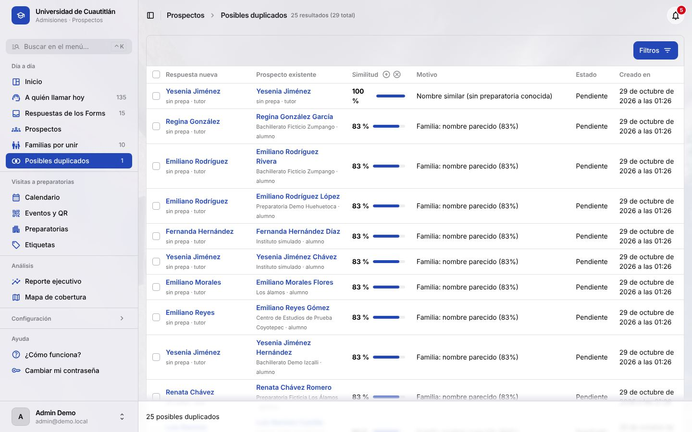

Dos respuestas que parecen de **la misma persona** (contestó dos veces, o con el nombre escrito distinto).
El programa **nunca** las une solo. Revisa cada una:

- **Es la misma persona: fusionar.** Se queda una ficha con todo el historial.
- **Son personas distintas: rechazar.**

Pistas: misma prepa, mismo apellido materno, el mismo teléfono. Si te equivocas al fusionar, se separa
desde la ficha (sección 6).

## 10. Visitas a preparatorias

### Calendario

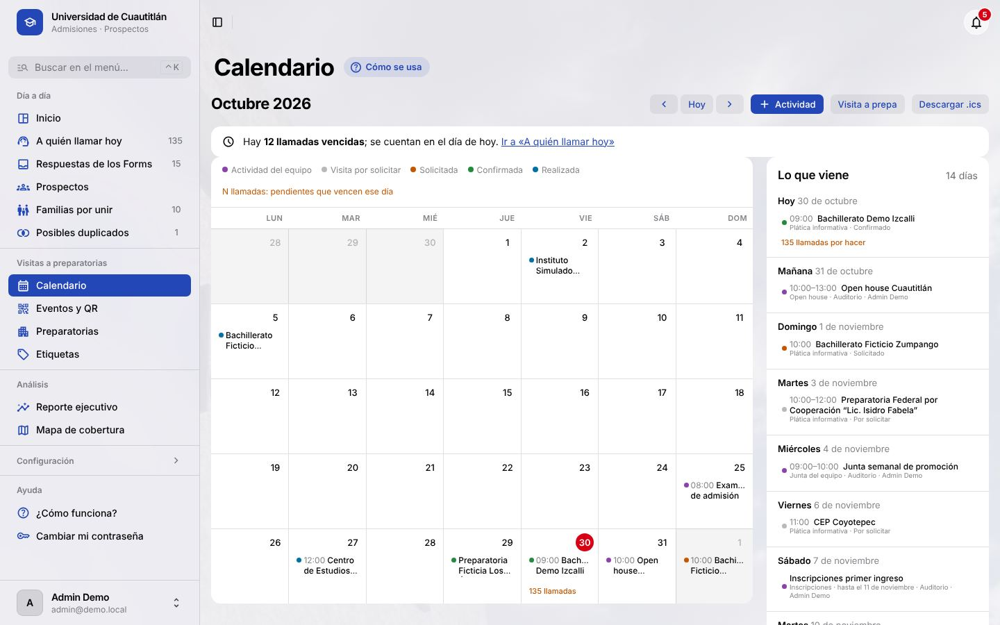

En un mes se ven las visitas, con un punto de color según su estado: por solicitar, solicitada, confirmada
o realizada. También las actividades del equipo (punto morado) y, en naranja, cuántas llamadas vencen cada
día.
- **+** en un día agrega una actividad (open house, examen, inscripciones, junta). Haz clic en ella
  para cambiarla o quitarla.
- **Descargar .ics** lo pasa a Google Calendar u Outlook. Es una copia: si algo cambia, descárgalo otra vez.

### Antes de la visita

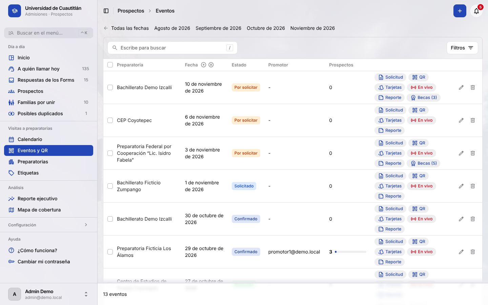

1. **Eventos y QR → Agregar evento:** preparatoria, fecha, horario, promotor, meta de registros y alumnos
   esperados. El código del evento se genera solo.
2. **Solicitud:** la carta para la preparatoria en hoja membretada de la UDC. Quién firma se cambia arriba
   de la carta.
3. **Cartas de beca** (si se entregan): en el evento, elige el tipo de carta (beca especial o regularización),
   el porcentaje, la vigencia y cuántas imprimir. En la lista aparece **Becas (N)**: imprime todas, o un rango
   de folios si se acabaron. Cada carta lleva un folio para saber de qué visita viene.

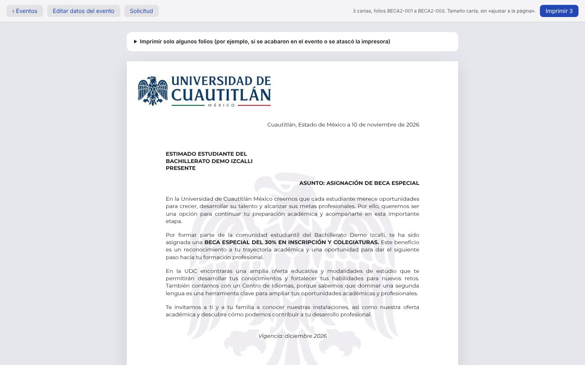

4. **QR** (para proyectar) y **Tarjetas** (una por alumno, con dos QR que comparten código de familia: uno
   para el alumno y otro para su familia). Las tarjetas unen a la familia **sin dudas**.

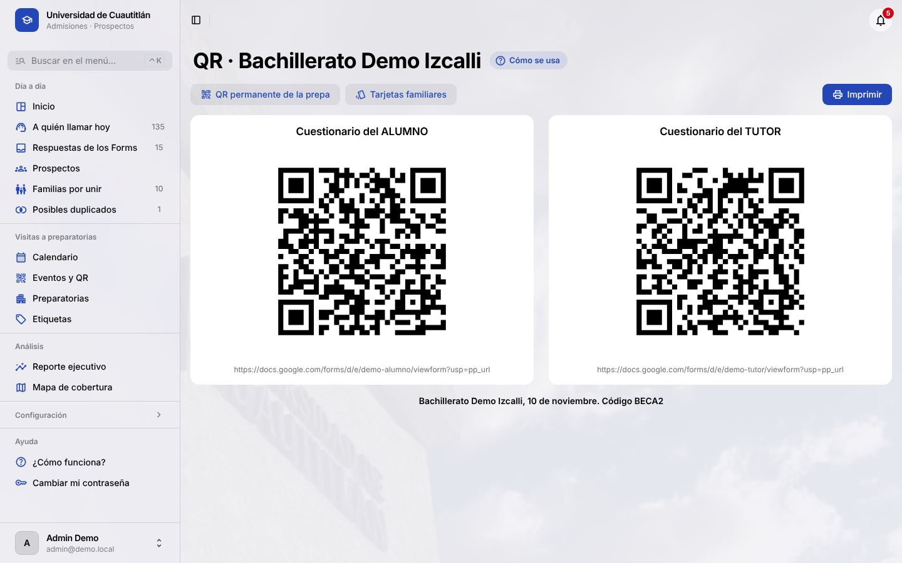

### Durante la visita

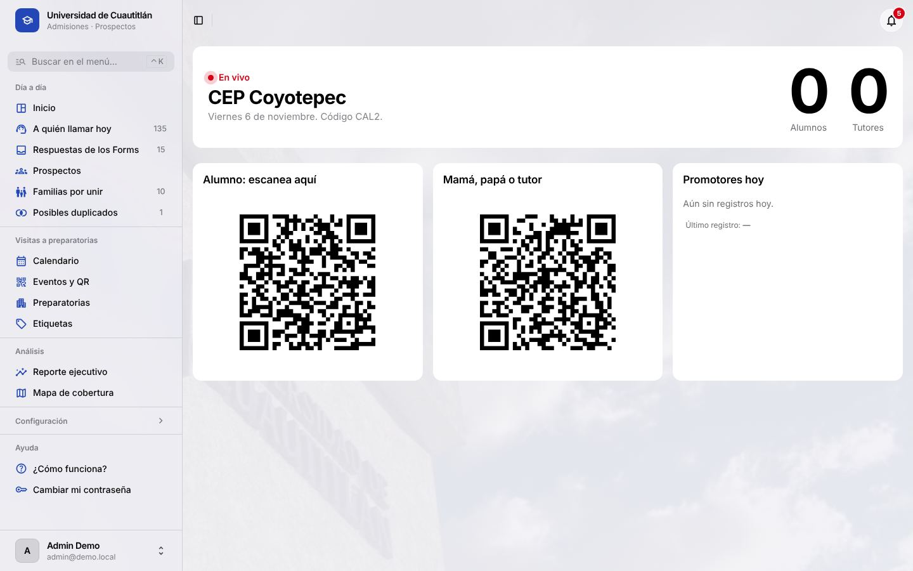

Abre **En vivo** en el proyector: contador, avance contra la meta y ranking de promotores. No muestra
nombres. Esta pantalla no cierra la sesión por inactividad.

### Después de la visita

El **Reporte** del evento resume cuántos se registraron, de qué carreras y cuánto costó cada registro.
Cambia el estado del evento a *Realizado*.

## 11. Preparatorias y mapa de cobertura

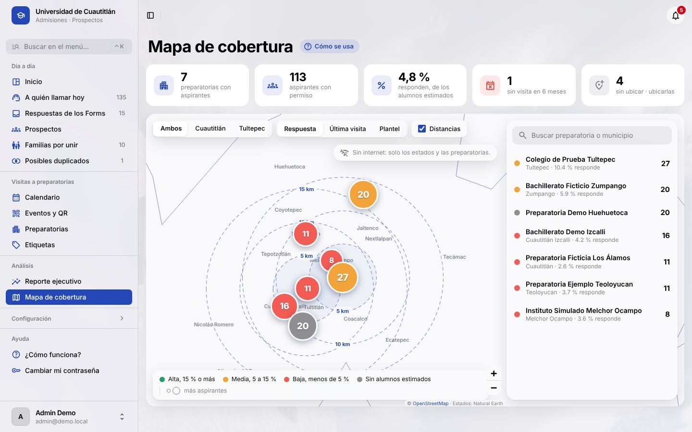

- Cada círculo es una prepa. Su tamaño y número indican cuántos aspirantes con permiso tiene.
- **Colorear por:**
  - **Respuesta:** qué parte de sus alumnos contestó. Verde 15 % o más, ámbar 5 a 15 %, rojo menos de 5 %.
  - **Última visita:** azul si ya hay una programada; verde menos de 3 meses, ámbar de 3 a 12, rojo más de un año o nunca.
  - **Plantel:** azul Cuautitlán, rosa Tultepec.
- A la derecha, la lista con buscador. Al elegir una prepa: **programar visita**, **ver aspirantes** y
  **QR permanente**.
- Los alumnos escriben su prepa a mano. Las nuevas aparecen como «por revisar» y sin ubicación. Si dos son
  la misma escuela, en **Preparatorias** selecciónalas y usa **Unir**. Para ponerlas en el mapa, usa
  **Ubicar**: búscala o haz clic donde está.

## 12. Reporte ejecutivo

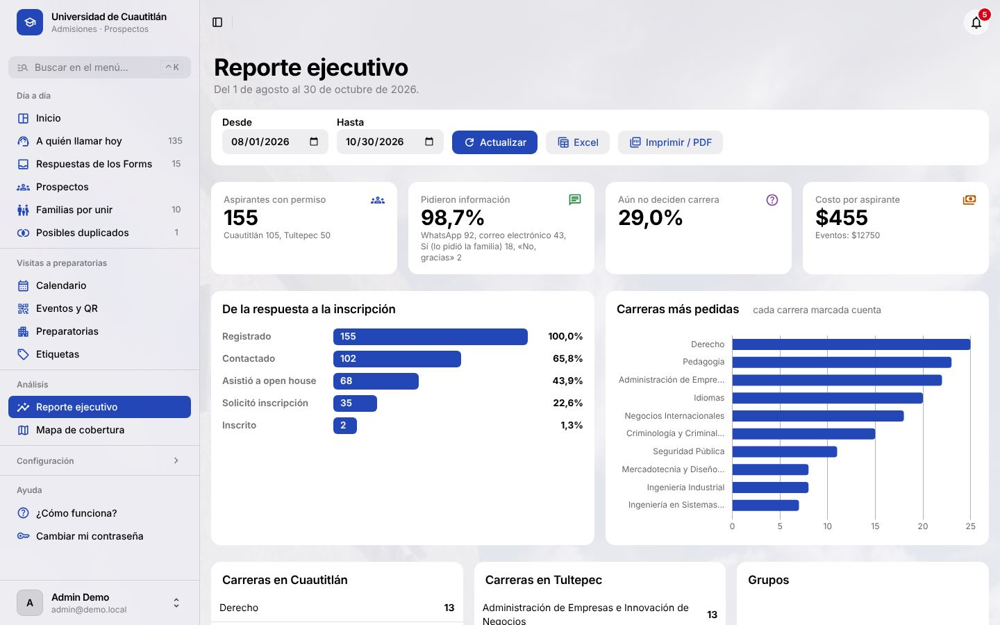

Para dirección: aspirantes del periodo, de dónde vienen, qué carreras piden, qué les importa al elegir
universidad y en qué no coinciden con su familia. Solo cifras, sin nombres. **Imprimir / PDF** lo
deja listo para una junta.

## 13. Cambiar las encuestas

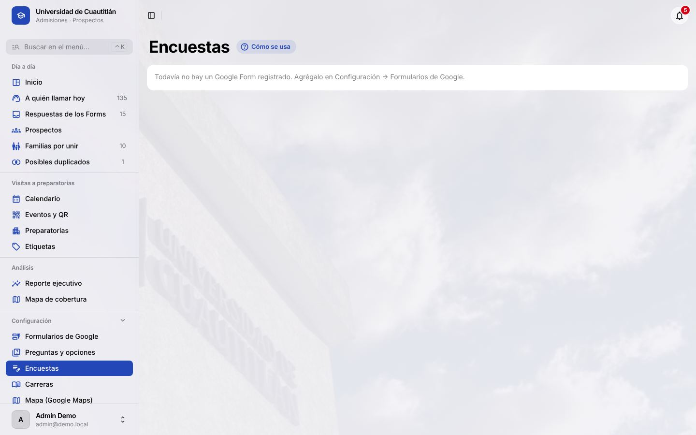

En **Configuración → Encuestas** (Coordinación y Administrador) se agregan, editan o quitan preguntas de los
Forms sin entrar a Google. Las preguntas que usa el programa para la prioridad y el permiso **no se pueden
borrar**, solo cambiar su texto. Al publicar, el Form de Google se actualiza.

## 14. Exportar y derechos de las personas (ARCO)

- **Exportar a Excel** (sin contacto) o **con datos de contacto**: este segundo queda en la bitácora. Borra
  el archivo cuando termines y no lo reenvíes por correo personal ni WhatsApp.
- **Si alguien pide borrar sus datos** (cancelación u oposición): en Prospectos, selecciónalo → acción
  **Anonimizar**, y escribe ANONIMIZAR para confirmar. Es irreversible: solo quedan cifras.
- **Si pide ver sus datos** (acceso): exporta su ficha con contacto y entrégasela por un medio seguro.

## 15. Preguntas frecuentes

| Pregunta | Respuesta |
|---|---|
| Un alumno dice que contestó y no aparece. | Busca en **Respuestas de los Forms**. Si está «Esperando permiso», falta su familia. Si no está, el programa estaba cerrado: se pone al día al abrirlo. |
| ¿Por qué un aspirante tiene prioridad 100? | En su ficha, pestaña **Prioridad y grupos**, dice de dónde salen los puntos. |
| Me salió «Se cerró tu sesión». | Pasaron 30 minutos sin uso. Vuelve a entrar; no se perdió nada. |
| Me salió «Demasiados intentos». | Espera 15 minutos o pide a un administrador que te restablezca la contraseña. |
| Uní a una familia con el alumno equivocado. | En la ficha, **No es la misma persona: separar**. |
| La campanita no avisa. | Revisa en **Avisos → Qué avisos recibir** que no los tengas apagados. Los avisos se generan solo mientras el programa está abierto en la PC del sistema. |
| El navegador dice que no se puede conectar. | Se cerró la ventana negra en la PC del sistema: vuelve a abrir *Prospectos.exe*. |
