# Prospectos · Manual de usuario

**Para:** Admisiones, coordinación, promotores y directivos de la Universidad de Cuautitlán.
**Versión del programa:** 1.0.0 (octubre de 2026). © 2026 NullSpace Studio.

Este manual explica cómo usar el programa día a día. Para instalarlo, respaldarlo o actualizarlo, ver el
*Manual de instalación y operación*. Dentro del programa, **Ayuda → ¿Cómo funciona?** tiene las mismas
guías, y cada pantalla tiene un botón **Cómo se usa** que abre la suya.

---

## 1. Qué hace el programa, en una frase

Junta las respuestas de los Google Forms que contestan los aspirantes y sus familias en las visitas a
preparatorias. Une al alumno con su familia, decide a quién llamar primero y lleva el seguimiento hasta
la inscripción, cuidando los datos de los menores.

El camino de una respuesta:

1. El alumno escanea el **QR** de la visita y contesta el Form. Su familia contesta el suyo.
2. En menos de 2 minutos el programa la trae, siempre que esté abierto en la PC de Admisiones.
3. Si es **menor de edad**, espera el **permiso** de su familia antes de poder usarse.
4. Se une con la respuesta de su familia, recibe una **prioridad de 0 a 100** y entra a **Prospectos → Llamar hoy**.
5. Un asesor lo contacta, registra la llamada y lo lleva por el embudo: Contactado → Open house →
   Solicitó inscripción → Inscrito.

## 2. Entrar

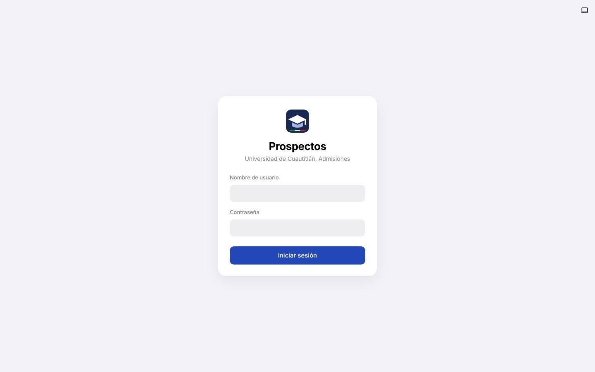

- En la computadora principal o en una ya conectada, doble clic en **Prospectos.exe** abre el programa en el
  navegador. Todas las computadoras ven la misma información, y tu usuario, perfil y foto son los mismos en cualquiera.
- Entra con tu correo y contraseña. La primera vez el programa te pide cambiar la contraseña temporal
  por una tuya de **12 caracteres o más**.
- **5 contraseñas equivocadas** bloquean tu usuario 15 minutos. Si se te olvidó, un administrador te
  la restablece.
- Si pasas **30 minutos sin usar** el programa, o cierras el navegador, la sesión se cierra sola. Es para
  que una computadora abierta no deje a la vista los datos de los aspirantes.
- Si activaste la **verificación en 2 pasos** (obligatoria para administradores), después de la contraseña
  se pide el código de 6 dígitos de la app de tu teléfono.

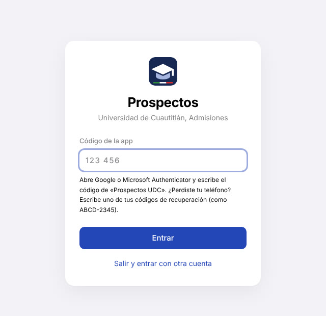

### Mi perfil

**Ayuda → Mi perfil** (o tu nombre, abajo del menú) junta lo tuyo:

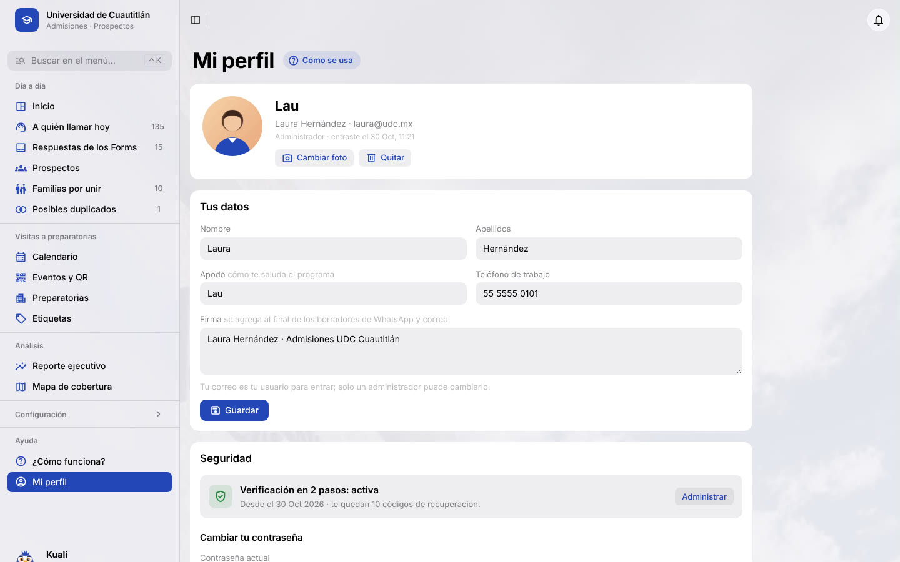

- **Foto:** «Poner foto», encuádrala arrastrando y con el control de acercar, y «Guardar foto». Se ve en el menú.
- **Apodo:** cómo te saluda el programa («Buenos días, Lau»).
- **Teléfono de trabajo y firma:** la firma se agrega al final de los borradores de WhatsApp que prepara Kuali.
- **Contraseña:** escribe la actual y la nueva dos veces (12 caracteres o más; mejor una frase).
- **Preferencias:** tema claro u oscuro, mostrar u ocultar a Kuali y qué avisos recibir en la campanita.
- Tu correo es tu usuario: solo un administrador puede cambiarlo.

### Verificación en 2 pasos

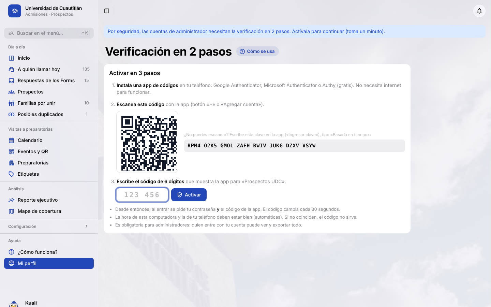

1. Instala en tu teléfono **Google Authenticator** o **Microsoft Authenticator** (gratis; funciona sin internet).
2. En Mi perfil → **Activar**, escanea el código QR con la app y escribe el código de 6 dígitos.
3. **Guarda los 10 códigos de recuperación** (imprímelos y guárdalos lejos de la computadora). Solo se muestran una vez;
   cada uno sirve para entrar **una vez** si pierdes el teléfono.

- Es **obligatoria para administradores**: al entrar, el programa los lleva a activarla. Para los demás es opcional.
- ¿El código no sirve? La hora del teléfono y la de la computadora deben estar en automático.
- ¿Perdiste el teléfono y los códigos? Otro administrador te la quita en **Configuración → Usuarios**.
- **5 códigos equivocados** bloquean la cuenta 15 minutos.
- **No en cada entrada:** al escribir el código, deja marcado *«No volver a pedirlo en esta computadora durante 30 días»*.
  Desde entonces solo se pide si algo se ve raro: entras desde **otra red**, hubo **contraseñas equivocadas** antes de entrar,
  **cambió tu contraseña** o pasaron los 30 días. No lo marques en una computadora pública o compartida con gente de fuera.
  En **Mi perfil → Seguridad** ves esas computadoras y puedes **Olvidarlas**.

**Qué ve cada rol**

| Rol | Ve y hace |
|---|---|
| **Administrador** | Todo, incluidos usuarios, respaldos, protección de datos y bitácora. |
| **Coordinación** | Lo de Admisiones, más preguntas, carreras, reglas de prioridad y usuarios (que no sean administradores). |
| **Admisiones** | A quién llamar, fichas con contacto, seguimiento, familias, duplicados, eventos y exportar. |
| **Promotor** | Sus eventos, QR, tarjetas, la pantalla En vivo y sus aspirantes, con el contacto oculto. |
| **Directivo** | Inicio, mapa y reporte ejecutivo: solo cifras, sin datos personales. |

### Cerrar sesión

Abajo a la izquierda, en tu nombre → **Cerrar sesión**. Se abre una ventana para confirmar: **Enter** cierra la sesión
y **Esc** cancela. Si tienes la verificación en 2 pasos y esta computadora es «de confianza», aparece
**Olvidar esta computadora**: márcala en una PC compartida, así la próxima vez se pedirá el código.

**Si no usas el programa 30 minutos, la sesión se cierra sola.** Mover el mouse o escribir cuenta como uso, aunque no
cambies de pantalla. Un minuto antes aparece **«¿Sigues ahí?»**: pulsa *Seguir trabajando* para continuar. Si nadie
responde, la pantalla se cambia a «Sesión cerrada» para que los datos no queden a la vista. Lo que no hayas guardado
en ese momento se pierde.

## 3. Inicio

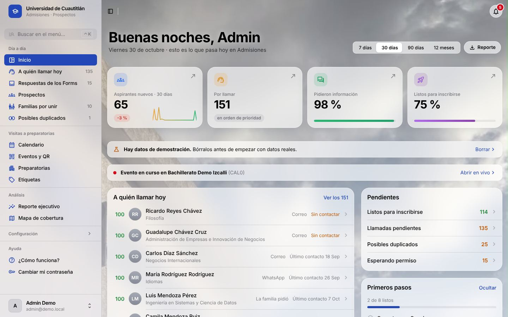

- Arriba, cuatro cifras del periodo elegido (7 días, 30 días, 90 días o 12 meses): **aspirantes
  nuevos**, **por llamar**, **% que pidió información** y **% listos para inscribirse**. Cada tarjeta lleva a
  su lista.
- Avisos amarillos o rojos si algo requiere atención: un evento en curso, datos de demostración o un Form
  que no se pudo leer.
- **Llamar hoy**: los primeros de la lista. **Pendientes**: cuántos hay en cada lista de trabajo.
- **Reporte** descarga el resumen del periodo.

## 4. Avisos (la campanita)

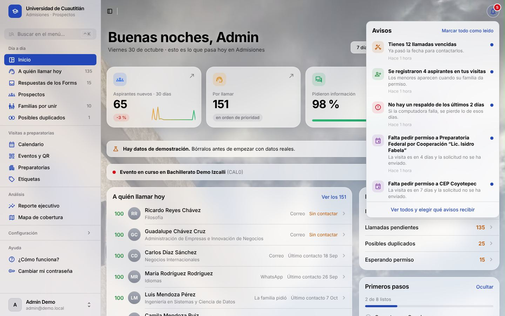

Arriba a la derecha. El número rojo indica cuántos avisos no has leído.

| Aviso | Cuándo llega |
|---|---|
| **Cada alumno que se registra** | Admisiones, Coordinación y administradores: un aviso por cada alumno que contesta el cuestionario, con su prepa, carrera y hora (sin nombre; **Ver** abre su ficha). Si es menor, dice que espera el permiso de su familia. Si llegan más de 10 juntos, por ejemplo cuando el programa estuvo cerrado, llega uno solo con la cifra. |
| **Aspirantes nuevos** | Promotores: cuando alguien te asigna uno, o cuando se registran con tu código o QR. Se juntan en uno solo mientras no lo abras. |
| **Llamadas vencidas** | Un aviso al día con la cifra («Tienes 12 llamadas vencidas»). |
| **Visitas** | Un día antes de cada visita (con cuántas cartas de beca llevar), y si a una semana aún no se pide permiso a la prepa. |
| **Problemas del sistema** | Solo administradores: respaldo que falló, copia externa sin hacer, Form que no se pudo leer. No se pueden apagar. |

- Al abrir un aviso, te lleva a lo que hay que hacer y se marca como leído.
- En **Ver todos** eliges qué avisos recibir.
- Los avisos no muestran nombres ni teléfonos y se borran solos a los 60 días.

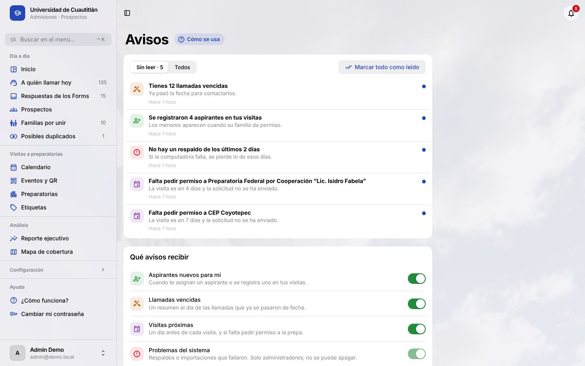

**Avisos nuevos:** aparece una ventanita en la esquina inferior derecha con **Ver** y suena un tono corto. Si el
programa está en una pestaña de fondo, el título de la pestaña parpadea. En **Mi perfil → Preferencias** puedes
apagar el sonido, probarlo, y activar *«Avisarme aunque esté en otra ventana»* para recibirlos como avisos de Windows.

**Si no suena:** el navegador solo deja sonar una página si llegaste a ella con un clic (por ejemplo, desde el menú) o
si ya hiciste clic en ella. Si abriste la pestaña escribiendo la dirección y no has tocado nada, el aviso sale con
*«El navegador bloqueó el sonido»*: haz clic ahí y suena. Para que suene siempre, aunque no toques la página, activa
*«Avisarme aunque esté en otra ventana»*: el aviso de Windows trae su propio sonido.

## 5. Kuali, el asistente

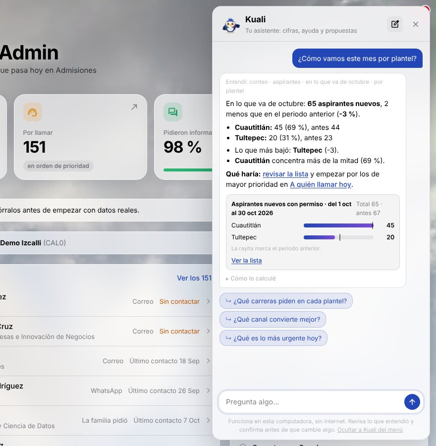

**Kuali** («bueno» en náhuatl) es el aguilucho que vive en el menú lateral, arriba de tu nombre. Es la mascota del programa y
también el asistente. Un administrador puede cambiarle el nombre en Configuración → Asistente.

- **No interrumpe.** Nunca aparece solo ni abre ventanas: solo cambia de cara según lo que pasa, y habla cuando le das clic.
- **Sus caras:** tranquilo; con un «!» y la frase «Tienes N avisos» si hay avisos sin leer; pensando mientras consulta; contento
  cuando se confirma algo; preocupado si algo falla; y dormido si nadie usa la computadora en 5 minutos.
- Si el menú está cerrado o estás en el celular, Kuali está arriba a la derecha, junto a la campanita.
- ¿No te gusta? En su ventana, abajo, **Ocultar a Kuali del menú**. Seguirá arriba a la derecha y se puede volver a mostrar.

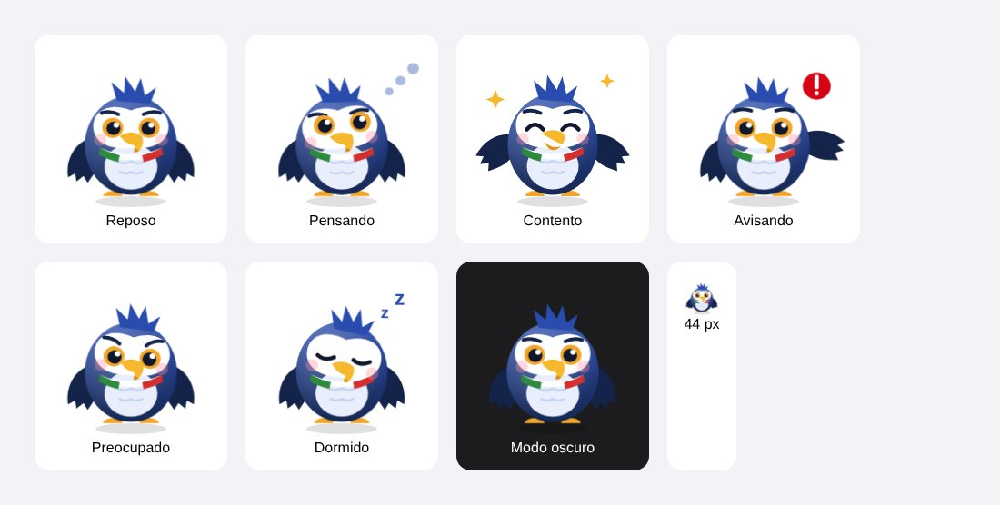

Al darle clic sirve para tres cosas:

- **Cifras:** «¿cuántos aspirantes llegaron este mes por plantel?», «¿qué carreras piden más en Tultepec?», «¿cómo va el
  embudo desde agosto?». Las cifras salen del programa. Debajo de la respuesta dice qué consultó. Los grupos de menos de 3
  aspirantes aparecen como «menos de 3».
- **Ayuda:** «¿cómo uno a una familia?», «¿qué significa Esperando permiso?». Responde con este manual.
- **Preparar llamadas y mensajes:** en la ficha de un aspirante, los botones **Preparar llamada**, **Borrador de WhatsApp** y
  **Diferencias con su familia**. El borrador trae un botón **Copiar**.

**Propuestas:** si le pides «agenda una visita a tal prepa el día tal», «agrega el open house al calendario» o «asigna los 10 de
mayor prioridad sin asesor a Fulana», te muestra una tarjeta con lo que hará, con los nombres, y **no cambia nada hasta que pulses
Confirmar**. No puede borrar, unir, exportar ni cambiar estatus.

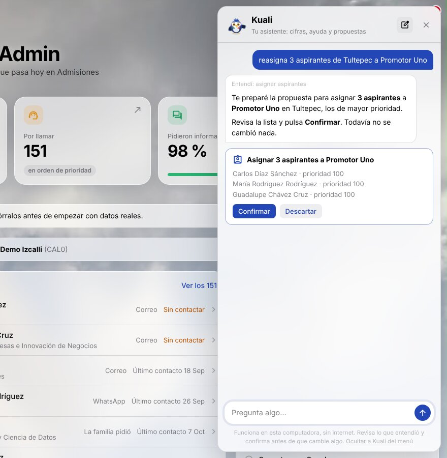

**Privacidad y costo.** Kuali es un programa propio que corre en esta computadora: **no usa internet ni inteligencia
artificial externa** y no cuesta nada. Por eso puede escribir el nombre real del aspirante en un borrador, y nada de lo que
preguntes sale de la UDC.

**Cómo entiende.** Con reglas: busca qué preguntas (cifras, comparaciones, embudo, conversión, visitas, pendientes, ayuda),
el periodo, el plantel, la carrera, la prepa y la persona del equipo. Arriba de cada respuesta dice **«Entendí: …»** con lo que
tomó; si no es lo que querías, reformula. Recuerda la pregunta anterior: después de «¿cómo vamos este mes?» basta «¿y en Tultepec?».
Si no entiende, te ofrece preguntas parecidas que sí sabe contestar.

**Cómo responde.** Primero la cifra, luego con qué se compara (el periodo anterior, el otro plantel, la meta), qué llama la atención
y qué haría, con el enlace a la lista exacta. Debajo trae:
- una **gráfica** con los números del programa (la rayita marca el periodo anterior);
- **Cómo lo calculé**: qué contó, de qué fechas, con qué filtros y un enlace a esos aspirantes, para que lo compruebes;
- **preguntas para seguir**: tócalas para profundizar sin escribir.

**Preguntas que dan mejores respuestas:**

| En vez de… | Pregunta… |
|---|---|
| «¿Cuántos aspirantes hay?» | «¿Cómo vamos este mes contra el anterior, por plantel?» |
| «¿Qué carreras piden?» | «¿Qué carreras piden en cada plantel?» |
| «¿Cómo va WhatsApp?» | «¿Qué canal convierte mejor: WhatsApp o correo?» |
| «¿Qué hago?» | «¿Qué es lo más urgente hoy?» |
| «¿Sirvieron las visitas?» | «¿Qué visitas rindieron más registros por costo?» |
| «¿Dónde fallamos?» | «¿En qué etapa del embudo se nos quedan más aspirantes?» |

Si no dices el periodo, toma los últimos 30 días y lo aclara. Con pocos casos (menos de 8) te avisa que el porcentaje no es confiable.

**Sus límites.** Solo entiende formas de preguntar que se le enseñaron. No conversa de otros temas ni opina, y puede tomar mal
una pregunta rara: revisa siempre el «Entendí». Si una pregunta frecuente no la entiende, avísale a quien da soporte para que
se la enseñe.

## 6. Prospectos: una sola lista con pestañas

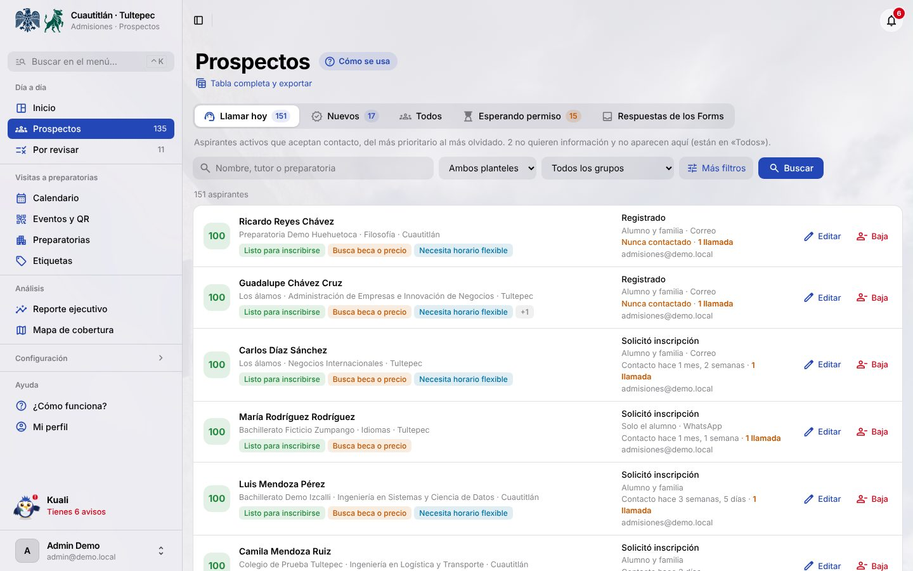

Todo lo de los aspirantes está en **Prospectos** (menú *Día a día*). Arriba eliges qué ver:

| Pestaña | Qué muestra |
|---|---|
| **Llamar hoy** | Aspirantes activos que aceptan contacto, del más prioritario al que lleva más tiempo sin contacto. |
| **Nuevos** | Los que llegaron en los últimos 7 días. |
| **Todos** | Todos los que dieron permiso, también inscritos, descartados y quienes no quieren información. |
| **Esperando permiso** | Menores sin el permiso de su familia (sección 8). |
| **Respuestas de los Forms** | Cada envío de los Forms tal como llegó (sección 8). |

- **Buscar:** nombre del aspirante, del tutor o de la prepa. Al lado, plantel, grupo y estatus.
  **Más filtros:** WhatsApp o correo, *Asignados a mí*, *Con llamadas pendientes* y *Alumno y familia contestaron
  distinto*. **Quitar filtros** regresa a la lista completa de esa pestaña.
- Cada fila dice la prioridad, la prepa y la carrera, sus grupos, el estatus, quién contestó (alumno, familia o
  ambos), cuándo fue el último contacto y su asesor.
- **Editar** abre la ficha (sección 7) para contactar, registrar lo que pasó o corregir datos.
- **Baja** (solo administradores): ver «Dar de baja» abajo.
- **Tabla completa y exportar** (debajo del título): la tabla con todas las columnas, para exportar a Excel o
  hacer cambios a varios a la vez.

Quien contestó **«No, gracias»** a recibir información no aparece en *Llamar hoy* y **no se le llama**.

### Dar de baja a un aspirante (y la pestaña «Bajas»)

El programa **no borra** registros: los **da de baja**. Se eliminan su nombre, teléfonos, correos, CURP y lo
que escribió, y queda solo como una cifra anónima en los reportes. Así se cumple la ley de datos personales
sin descuadrar las estadísticas. **No se puede deshacer.**

1. Pulsa **Baja** en su fila.
2. Elige el motivo: *Pidió que se borren sus datos*, *Es una prueba o datos basura* u *Otro* (escríbelo).
3. Escribe **BAJA** para confirmar.

Queda en la bitácora quién lo hizo, cuándo y por qué. Si la persona solo ya no quiere que la llamen, **no la
des de baja**: abre su ficha y marca «No quiere información».

Quien se da de baja **sale de las cifras de aspirantes interesados**: Inicio, Reporte ejecutivo, mapa y Kuali.
Pasa a la pestaña **Prospectos → Bajas**, que tiene su propia cuenta: total, las de este mes y cuántas por cada
motivo, con filtro por motivo y por plantel. Ahí aparece solo como «Baja #número», con su prepa, carrera, plantel y
fechas, sin nombre. El Reporte ejecutivo muestra aparte cuántas bajas hubo en el periodo.

## 7. La ficha del aspirante

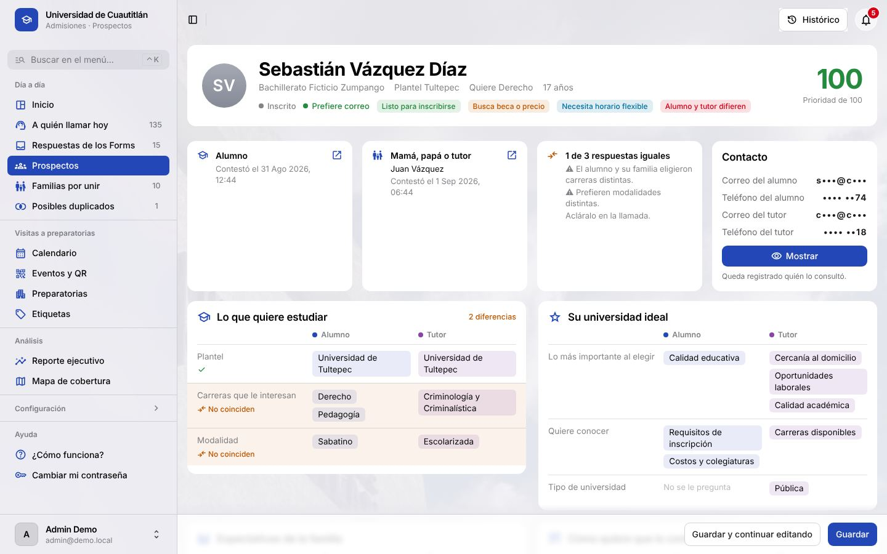

- **Arriba:** nombre, prepa, prioridad (de 0 a 100) y estatus.
- **Alumno / Familia / Coincidencias:** si contestó el alumno, si contestó su familia y en qué no están
  de acuerdo. Por ejemplo, si el alumno quiere Derecho y la familia Ingeniería, la llamada es distinta.
- **Respuestas por tema**, con el alumno y la familia lado a lado. Las que no coinciden se marcan en ámbar.
- **Contacto:** el correo y el teléfono aparecen ocultos. **Mostrar** los revela y deja registro de quién
  los vio.
- **Registrar contacto o nota:** el tipo (llamada, WhatsApp, correo, visita o nota interna), la fecha y lo que
  se habló. El primer contacto real pasa al aspirante a *Contactado* y cierra sus llamadas pendientes. Una
  nota interna no cuenta como contacto.
- **Estatus:** cámbialo conforme avance: Contactado → Asistió a open house → Solicitó inscripción →
  Inscrito, o Descartado.
- **Asesor:** asígnalo a alguien y esa persona recibe un aviso.
- Si pasan **5 días sin contacto**, el programa crea una llamada pendiente.

**Si la ficha junta a dos personas distintas** aparece el aviso «Esta ficha junta … respuestas» con el botón
**No es la misma persona: separar**. Las dos vuelven a ser fichas independientes y el programa ya no las
une solo. Un correo de bienvenida que ya se haya enviado no se puede deshacer.

## 8. Respuestas de los Forms: «contestaron y no aparece»

En **Prospectos → Respuestas de los Forms** (o **Esperando permiso**, para ver solo las retenidas).

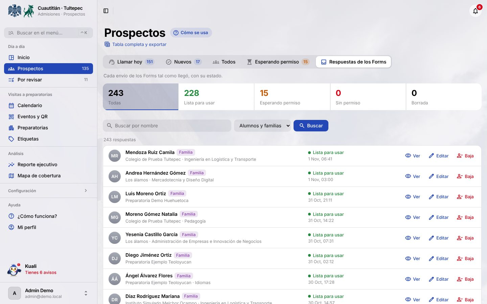

Aquí está **todo** lo que llegó, aunque todavía no se pueda usar:

| Estado | Qué significa | Qué hacer |
|---|---|---|
| **Lista para usar** | Ya está en Prospectos y en la lista de llamadas. | Nada. |
| **Esperando permiso** | Menor de edad, o no dijo su edad, sin el permiso de su familia. | Que la familia conteste su Form con el código de la tarjeta, o **Pedir el permiso del tutor** (abajo). Si en 30 días no llega, se borra. |
| **Sin permiso** | No aceptó el aviso de privacidad. | Nada: no se puede usar. |
| **Borrada** | Venció la espera o la persona pidió borrar sus datos. | Nada. |

**Pedir el permiso del tutor por teléfono:** abre la respuesta → *Pedir el permiso del tutor*. Llama
**solo para pedir el permiso**, explica el aviso de privacidad y, si acepta, registra el nombre del tutor
y el medio (llamada, WhatsApp, en persona, por escrito). Queda tu nombre, la fecha y el medio.

Si una respuesta **ni siquiera aparece aquí**: el programa estaba cerrado (se pone al día al abrirlo) o
el Form tiene un problema de conexión (aviso rojo en el Inicio).

## 9. Por revisar: familias por unir

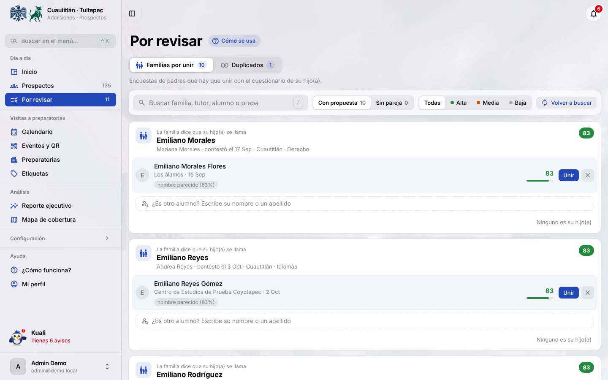

**Por revisar** (menú *Día a día*) junta todo lo que necesita que una persona decida. Tiene dos pestañas:
**Familias por unir** y **Duplicados**. El número del menú es la suma de las dos.

La encuesta de la familia y el cuestionario del alumno llegan por separado. Si el programa está seguro,
los une solo. Si duda, aparecen aquí: **una tarjeta por familia** con sus posibles hijos(as), el más
probable primero, con sus puntos y por qué se parecen.

- **Unir** en el correcto. La **✕** si ese no es. **Ninguno es su hijo(a)** si no es ninguno.
- **Buscador de arriba:** familia, tutor, alumno o prepa. No importan los acentos ni las variantes
  comunes («Jimena» encuentra «Ximena»). La tecla **/** lleva directo al buscador.
- **Alta / Media / Baja:** filtra por qué tan seguro está el programa (Alta: 60 puntos o más).
- **¿Es otro alumno?** dentro de la tarjeta: escribe el nombre del hijo(a) si no está entre las
  propuestas. Si no tiene nada en común con la familia, el botón pide un segundo clic para confirmar.
- **Sin pareja:** encuestas de familias que todavía no tienen ninguna propuesta. Si el alumno aún no
  contesta, déjala: se unirá sola cuando conteste.

> **Importante:** mientras un menor no se une con su familia, el permiso que dio la familia no le llega y
> sigue «Esperando permiso». Revisa esta pantalla al menos dos veces por semana.

## 10. Por revisar: duplicados

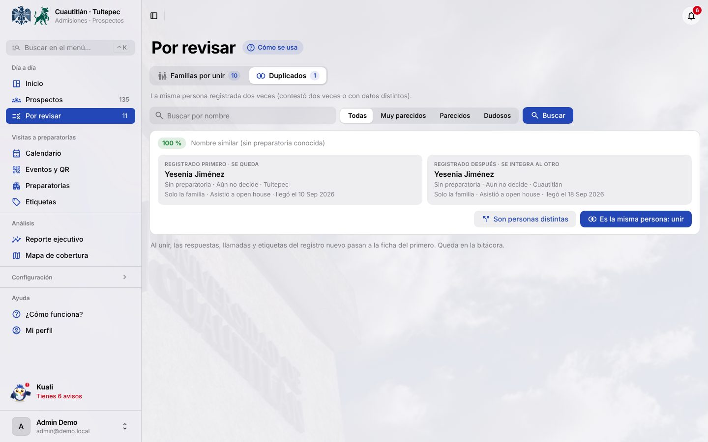

Dos registros que parecen de **la misma persona** (contestó dos veces, o con el nombre escrito distinto).
El programa **nunca** los une solo. Cada par aparece **una sola vez**, con los dos registros lado a lado:
el que llegó primero (se queda) y el que llegó después (se integra al otro). Pulsa cualquiera para abrir su
ficha en otra pestaña.

- **Es la misma persona: unir.** Queda una ficha con todo el historial de las dos.
- **Son personas distintas.** No se vuelven a proponer.
- Filtros: buscar por nombre, y *Muy parecidos / Parecidos / Dudosos*.

Pistas: misma prepa, mismo apellido materno, el mismo teléfono. Si te equivocas al unir, se separa
desde la ficha (sección 7). El historial completo (unidos y descartados) está en
*Configuración → Bitácora* y en la tabla de coincidencias.

## 11. Visitas a preparatorias

### Calendario

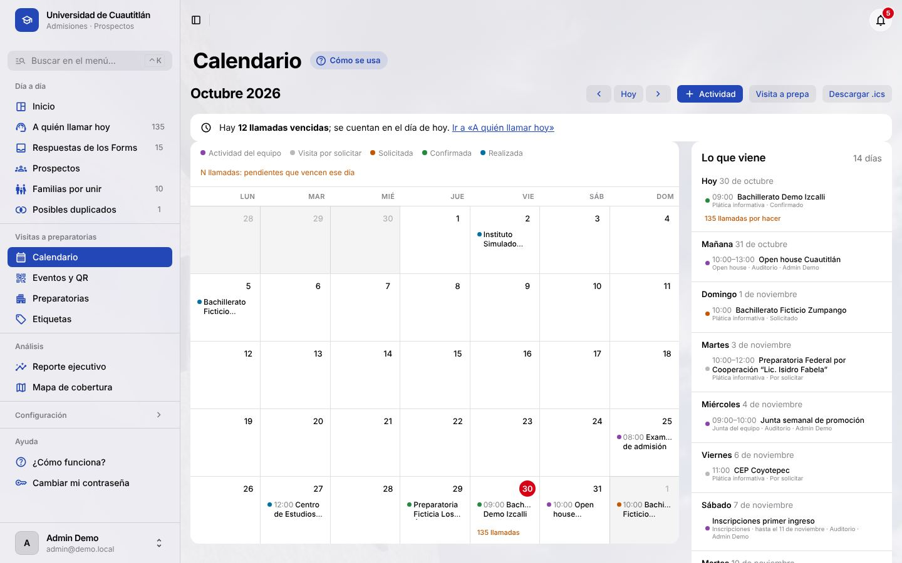

En un mes se ven las visitas, con un punto de color según su estado: por solicitar, solicitada, confirmada
o realizada. También las actividades del equipo (punto morado) y, en naranja, cuántas llamadas vencen cada
día.
- **+** en un día agrega una actividad (open house, examen, inscripciones, junta). Haz clic en ella
  para cambiarla o quitarla.
- **Descargar .ics** lo pasa a Google Calendar u Outlook. Es una copia: si algo cambia, descárgalo otra vez.

### Antes de la visita

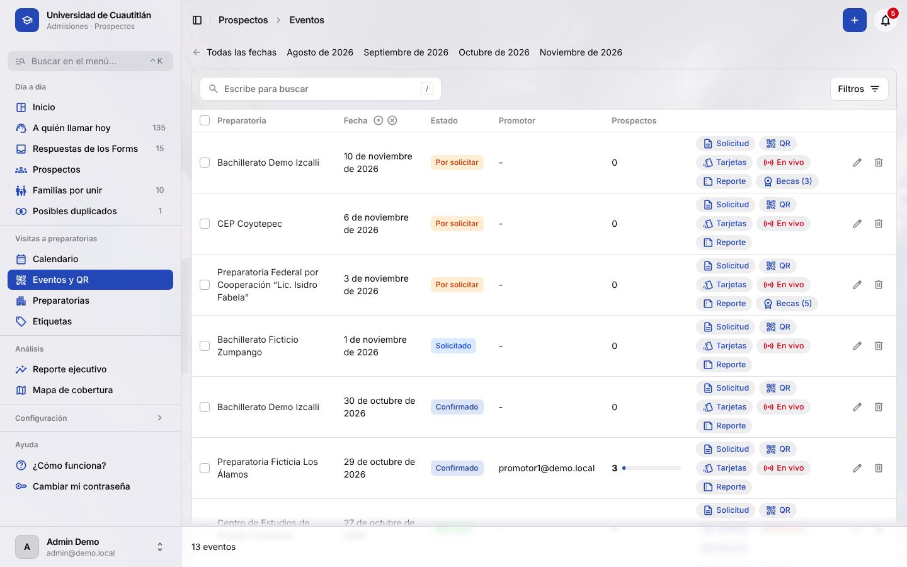

1. **Eventos y QR → Agregar evento:** preparatoria, fecha, horario, promotor, meta de registros y alumnos
   esperados. El código del evento se genera solo.
2. **Solicitud:** la carta para la preparatoria en hoja membretada de la UDC. Quién firma se cambia arriba
   de la carta.
3. **Cartas de beca** (si se entregan): en el evento, elige el tipo de carta (beca especial o regularización),
   el porcentaje, la vigencia y cuántas imprimir. En la lista aparece **Becas (N)**: imprime todas, o un rango
   de folios si se acabaron. Cada carta lleva un folio para saber de qué visita viene.

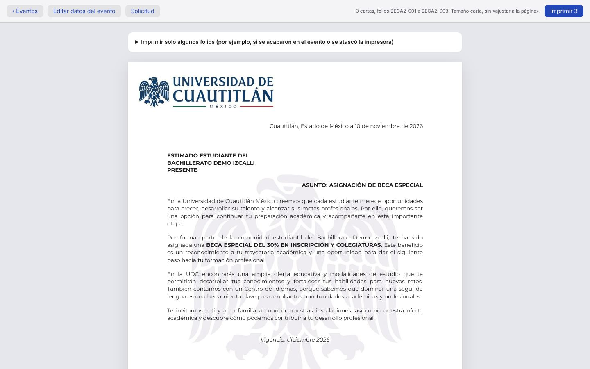

4. **QR** (para proyectar) y **Tarjetas** (una por alumno, con dos QR que comparten código de familia: uno
   para el alumno y otro para su familia). Las tarjetas unen a la familia **sin dudas**.

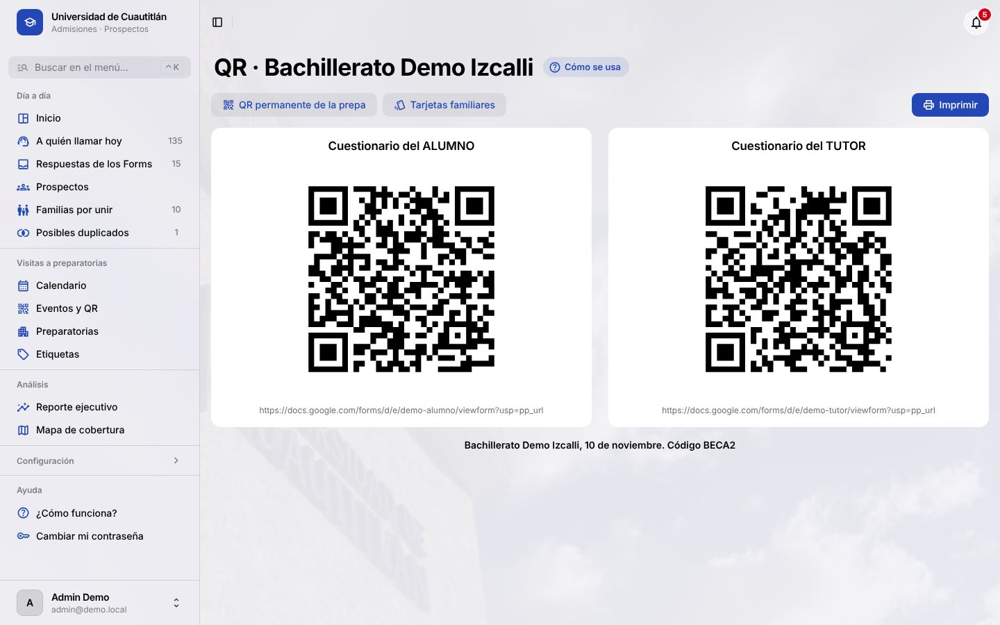

### Durante la visita

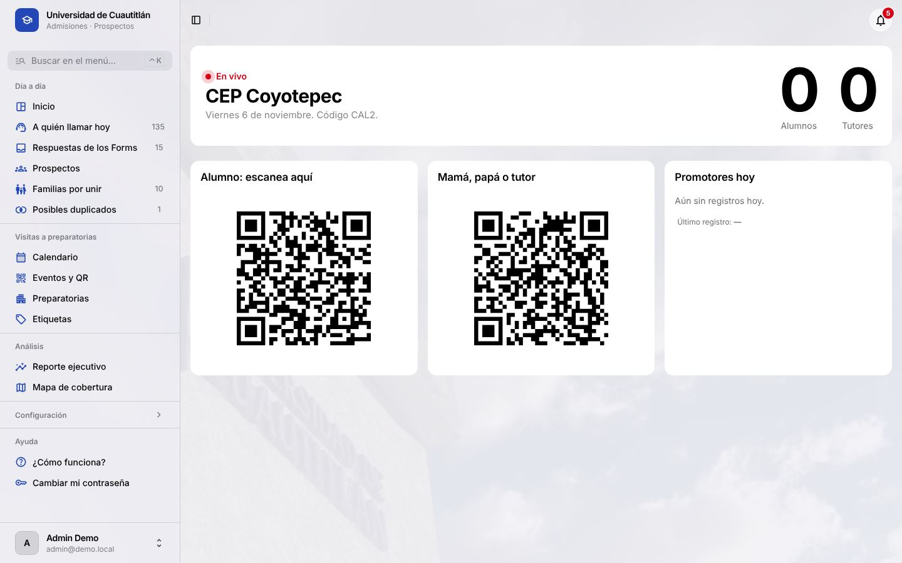

Abre **En vivo** en el proyector: contador, avance contra la meta y ranking de promotores. No muestra
nombres. Esta pantalla no cierra la sesión por inactividad.

### Después de la visita

El **Reporte** del evento resume cuántos se registraron, de qué carreras y cuánto costó cada registro.
Cambia el estado del evento a *Realizado*.

## 12. Preparatorias y mapa de cobertura

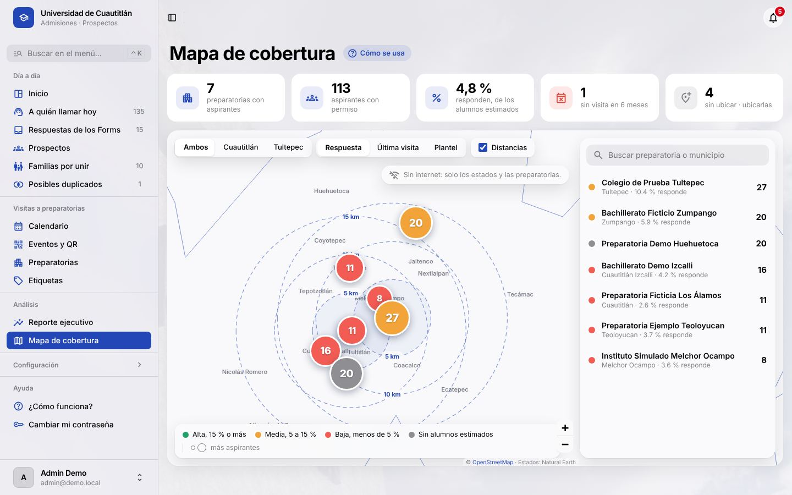

- Cada círculo es una prepa. Su tamaño y número indican cuántos aspirantes con permiso tiene.
- **Colorear por:**
  - **Respuesta:** qué parte de sus alumnos contestó. Verde 15 % o más, ámbar 5 a 15 %, rojo menos de 5 %.
  - **Última visita:** azul si ya hay una programada; verde menos de 3 meses, ámbar de 3 a 12, rojo más de un año o nunca.
  - **Plantel:** azul Cuautitlán, rosa Tultepec.
- A la derecha, la lista con buscador. Al elegir una prepa: **programar visita**, **ver aspirantes** y
  **QR permanente**.
- Los alumnos escriben su prepa a mano. Las nuevas aparecen como «por revisar» y sin ubicación. Si dos son
  la misma escuela, en **Preparatorias** selecciónalas y usa **Unir**. Para ponerlas en el mapa, usa
  **Ubicar**: búscala o haz clic donde está.
- **Planteles:** cada uno aparece con el escudo de su universidad. Si falta uno, un administrador ve el botón
  **Ubicar Tultepec** (o el que falte). Púlsalo, acerca el mapa hasta ver el edificio y haz clic sobre él; puedes
  arrastrar el escudo antes de **Guardar aquí**. También puedes pegar las coordenadas o el enlace de Google Maps.

## 13. Reporte ejecutivo

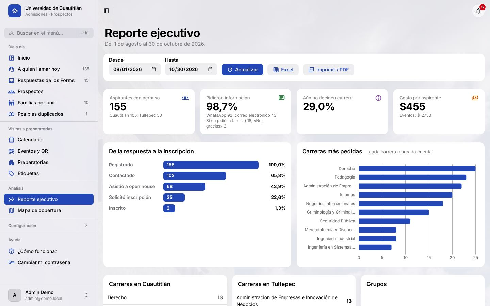

Para dirección: aspirantes del periodo, de dónde vienen, qué carreras piden, qué les importa al elegir
universidad y en qué no coinciden con su familia. Solo cifras, sin nombres. **Imprimir / PDF** lo
deja listo para una junta.

## 14. Cambiar las encuestas

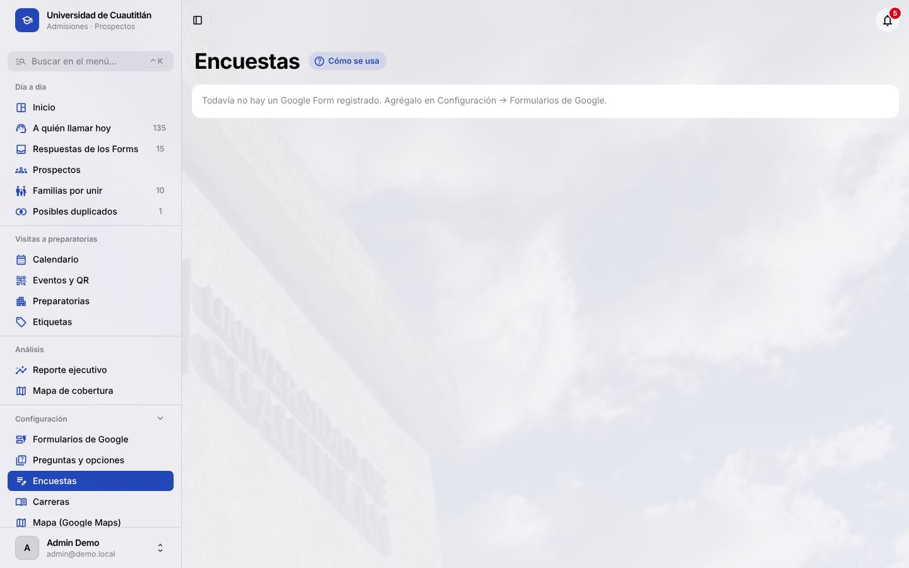

En **Configuración → Encuestas** (Coordinación y Administrador) se agregan, editan o quitan preguntas de los
Forms sin entrar a Google. Las preguntas que usa el programa para la prioridad y el permiso **no se pueden
borrar**, solo cambiar su texto. Al publicar, el Form de Google se actualiza.

- A la izquierda están **todas las encuestas**: la de aspirantes y la de **padres o tutores**. Elige una para verla.
- **Contestar** abre la encuesta como la ve quien la llena; **QR** muestra un código para contestarla desde el celular.
- Si el programa no puede conectarse con Google, igual se ven las preguntas que espera esa encuesta.

**Nueva encuesta.** Botón **Nueva encuesta**: título, para quién es (aspirantes o padres) y con qué preguntas empieza
(**copia del Form actual** o **solo las preguntas del programa**). El programa la crea en Google, la publica, la registra y
la importa cada minuto, como las demás. **No cambia los QR de las visitas**: siguen abriendo la encuesta de siempre hasta
que, en esa encuesta, pulses **Usar para los QR de las visitas**. Las imágenes o videos del Form original no se copian.

## 15. Exportar y derechos de las personas (ARCO)

- **Exportar a Excel** (sin contacto) o **con datos de contacto**: este segundo queda en la bitácora. Borra
  el archivo cuando termines y no lo reenvíes por correo personal ni WhatsApp.
- **Si alguien pide borrar sus datos** (cancelación u oposición): en Prospectos, selecciónalo → acción
  **Anonimizar**, y escribe ANONIMIZAR para confirmar. Es irreversible: solo quedan cifras.
- **Si pide ver sus datos** (acceso): exporta su ficha con contacto y entrégasela por un medio seguro.

## 16. Preguntas frecuentes

| Pregunta | Respuesta |
|---|---|
| Sale «El formulario caducó» o «La página de acceso había caducado». | Esa pestaña estaba abierta desde antes de entrar o salir en otra. No se guardó nada: vuelve a escribir y pulsa el botón otra vez. Si dice que el navegador no guardó la cookie, desbloquea las cookies para la dirección del programa o sal del modo privado. |
| Un alumno dice que contestó y no aparece. | Busca en **Prospectos → Respuestas de los Forms**. Si está «Esperando permiso», falta su familia. Si no está, el programa estaba cerrado: se pone al día al abrirlo. |
| ¿Por qué un aspirante tiene prioridad 100? | En su ficha, pestaña **Prioridad y grupos**, dice de dónde salen los puntos. |
| Me salió «Se cerró tu sesión». | Pasaron 30 minutos sin uso. Vuelve a entrar; no se perdió nada. |
| ¿El asistente puede ver los datos de un aspirante? | No. Recibe cifras y categorías, nunca nombres ni teléfonos. Ver sección 5. |
| Me salió «Demasiados intentos». | Espera 15 minutos o pide a un administrador que te restablezca la contraseña. |
| Uní a una familia con el alumno equivocado. | En la ficha, **No es la misma persona: separar**. |
| La campanita no avisa. | Revisa en **Avisos → Qué avisos recibir** que no los tengas apagados. Los avisos se generan solo mientras el programa está abierto en la PC del sistema. |
| El navegador dice que no se puede conectar. | Se cerró la ventana negra en la PC del sistema: vuelve a abrir *Prospectos.exe*. |
