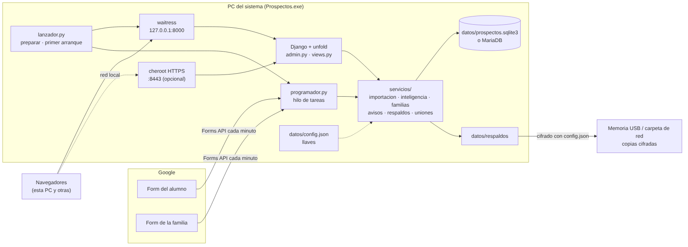
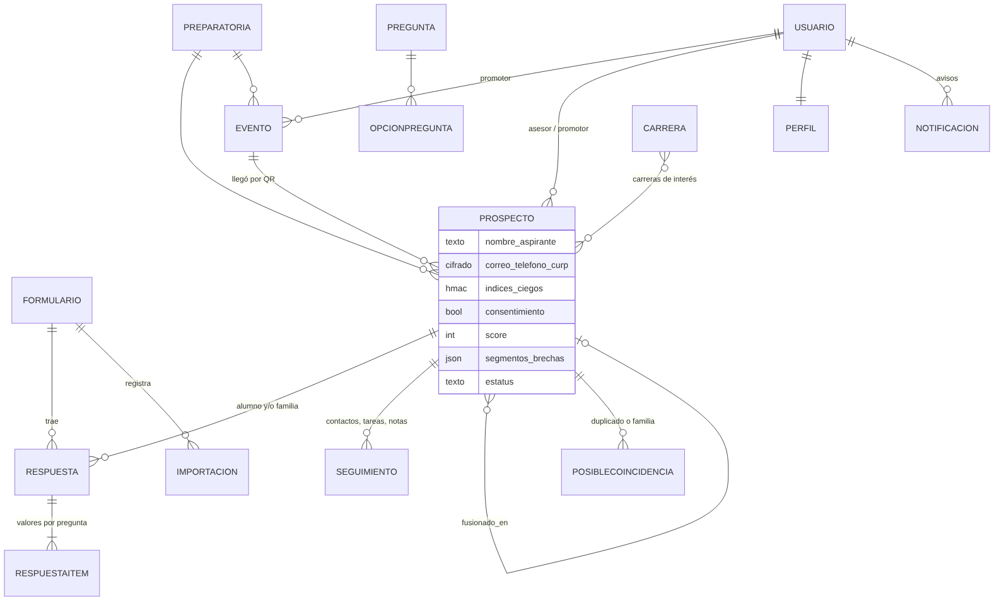

# Prospectos · Documentación técnica

**Para:** quien dé mantenimiento al programa después de sus autores.
**Versión:** 1.0.0 (octubre de 2026). © 2026 NullSpace Studio. Programa propietario: ver `LICENSE`.

Las decisiones de diseño, con el porqué y lo que se sacrificó en cada una, están en `docs/decisiones.md`.
Léela antes de cambiar algo que parezca raro: casi siempre hay una razón.

---

## 1. Panorama



| Pieza | Tecnología |
|---|---|
| Lenguaje | Python 3.13 |
| Web | Django 6.1 con el tema **django-unfold** 0.110 (todo el panel es el admin de Django) |
| Servidor | **waitress** en `127.0.0.1` y **cheroot** con TLS en `:8443` para la red local (opcional) |
| Base | **SQLite** en `datos/prospectos.sqlite3` por omisión; **MariaDB 10.11+** opcional (`docs/mariadb.md`) |
| Estáticos | whitenoise; CSS de marca con **Tailwind 4** (`estilos/udc.css`) |
| Tareas periódicas | Un hilo propio (`prospectos/programador.py`), sin cron ni Celery |
| Google | Forms API con cuenta de servicio u OAuth (`google-auth`, `google-auth-oauthlib`) |
| Cifrado | `cryptography` (Fernet) para campos personales y copias externas; HMAC-SHA256 para índices ciegos |
| Distribución | **PyInstaller** 6.22: carpeta portable `Prospectos/` con `Prospectos.exe` (Windows) o `Prospectos.app` (Mac) |

**Por qué un programa local y no un servidor en la nube:** la universidad no tenía servidor ni
presupuesto, y los datos de menores se quedan en una computadora de Admisiones. El costo es que la
PC del sistema es un punto único de falla, y por eso existen la copia externa cifrada y la llave de
recuperación.

## 2. Estructura del código

| Ruta | Qué hay |
|---|---|
| `lanzador.py` | Entrada del ejecutable: `preparar` (migra y siembra), primer arranque (D/A), programador, waitress, navegador. Con argumentos, ejecuta comandos de Django (`Prospectos.exe respaldo listar`). |
| `config/settings.py` | Configuración; lee `datos/config.json` (lo crea con llaves nuevas la primera vez). Menú lateral de unfold (`UNFOLD['SIDEBAR']`). |
| `config/version.py` | Versión y autoría que muestran «Acerca de» y el `.exe` (`version.txt`). |
| `prospectos/models.py` | Modelo de datos (sección 3). |
| `prospectos/admin.py` | Listas y fichas del panel. `AccionesFila` agrega botones de editar y eliminar por fila según los permisos. |
| `prospectos/views.py` | Pantallas propias: Inicio, A quién llamar, Respuestas, Familias por unir, mapa, calendario, eventos (QR, tarjetas, solicitud, becas, en vivo), reportes, encuestas, apariencia, ayuda. |
| `prospectos/vistas_avisos.py` | Campanita: bandeja, panel, contador y preferencias. |
| `prospectos/vistas_proteccion.py` | Protección de datos: copia externa, llave de recuperación y separar uniones. |
| `prospectos/vistas_asistente.py` | Asistente: conversación, confirmación de propuestas y configuración (llave cifrada, tope, modelo, nombre de la mascota). |
| `templates/prospectos/_kuali.svg.html` | Kuali, la mascota: un SVG con capas por estado (`.k-pensando-on`, `.k-contento-on`, `.k-avisando-on`, `.k-preocupado-on`, `.k-dormido-on`) que anima `udc.css`; `asistente.js` cambia los estados. Va en el menú (`unfold/helpers/navigation_user.html`) y en el encabezado. |
| `prospectos/middleware.py` | Cambio de contraseña obligatorio, `Referer` solo en el mapa, bloqueo por intentos y cierre por inactividad. |
| `prospectos/programador.py` | Tareas periódicas (sección 6). |
| `prospectos/servicios/` | La lógica, separada de las vistas (sección 4). |
| `prospectos/catalogos.py` | Preguntas y opciones del cuestionario base (los códigos internos). |
| `prospectos/management/commands/` | Comandos: `preparar`, `demo`, `crear_admin`, `respaldo`, `retencion`, `importar_respuestas`, `registrar_formulario`, `probar_google`, `conectar_google`, `recalcular`, `sincronizar_preguntas`, `pasar_a_mariadb`, `clasificar_ia`, `tareas_seguimiento`. |
| `prospectos/templates/` | Plantillas. `prospectos/base.html` define los bloques `ayuda`, `subtitulo` y `pagina`. |
| `prospectos/static/prospectos/` | JS por pantalla, CSS compilado, fuentes, Leaflet, GeoJSON y la marca de la UDC. |
| `estilos/udc.css` | **Fuente** del CSS (Tailwind 4). No edites el compilado. |
| `estilos/traducciones.py` | Traducciones del tema; genera `prospectos/locale/es/LC_MESSAGES/django.mo`. |
| `tests/` | Pruebas con pytest (sección 9). |
| `empaquetado/` | LEEME de Windows, ícono y la construcción para Mac. |
| `prospectos.spec`, `version.txt` | Receta de PyInstaller y propiedades del `.exe`. |

## 3. Modelo de datos



| Modelo | Para qué | Notas |
|---|---|---|
| `Formulario` | Un Google Form registrado | `mapeo_campos` (id de pregunta de Google → código interno) y `campos_prellenado` (`entry.N` para QR). |
| `Importacion` | Cada corrida del importador | Estado y mensaje de error: alimenta el aviso «No se pudieron traer las respuestas». |
| `Respuesta` | Una respuesta cruda de un Form | `raw_json` **cifrado**; `hash` por (formulario, responseId) la hace idempotente; `cuestionario` es alumno o tutor. |
| `RespuestaItem` | Valor por pregunta | `valor` y `valor_normalizado` (la opción del catálogo). Nunca guarda correos ni teléfonos. |
| `Prospecto` | La ficha: alumno y su familia unidos | Contacto **cifrado** (`CampoCifrado`) más índice ciego `*_bi` para buscar duplicados sin descifrar. `fusionado_en` apunta a la ficha que lo absorbió; las fusionadas no se borran. |
| `Seguimiento` | Contactos, notas, tareas, cambios de estatus | Las tareas automáticas tienen `automatica=True` y `vence_en`. |
| `PosibleCoincidencia` | Duplicados y propuestas de familia | El `motivo` que empieza con «Familia» es una propuesta de familia. Las `rechazadas` impiden volver a unir a esa pareja. |
| `Preparatoria`, `Carrera`, `Etiqueta`, `Pregunta`, `OpcionPregunta` | Catálogos | Las preguntas «del sistema» no se borran: las usan las reglas. |
| `Evento`, `Actividad` | Visitas a prepas y calendario | El código del evento viaja en el QR; cartas de beca con folio. |
| `Perfil` | Datos extra del usuario | Código de promotor, cambio de contraseña obligatorio, avisos apagados. |
| `Notificacion` | Avisos de la campanita | Sin datos personales; `clave` evita repetir el mismo aviso. |
| `Configuracion` | Clave/valor en JSON | Pesos de prioridad, apariencia, carpeta de copia externa, estado del programador. |
| `Auditoria` | Bitácora **de solo inserción** | `save()` y `delete()` lanzan error si ya existe. Guarda IDs y nombres de campo, nunca valores personales. |
| `Respaldo` | Cada respaldo creado | Estado, SHA-256 y fecha de verificación. |

**Roles:** grupos de Django (`semillas.preparar()` los crea y actualiza): Administrador, Coordinación,
Admisiones, Promotor y Directivo. Los promotores se filtran por consulta con `ver_propios` y
`ver_eventos_propios`.

## 4. Servicios (la lógica)

| Módulo | Responsabilidad |
|---|---|
| `fuentes.py` | Leer los Forms: Forms API (cuenta de servicio u OAuth) o una fuente en memoria (demo y pruebas). Traduce errores HTTP a mensajes claros. |
| `importacion.py` | Importación **idempotente e incremental**: mapear, normalizar opciones contra el catálogo, guardar la respuesta y enlazarla. Un candado por formulario. |
| `inteligencia.py` | `enlazar` (código de familia → contacto → nombre), `recalcular` (rearma la ficha desde sus respuestas: permiso, prioridad, grupos, diferencias), `fusionar` y `rechazar`. |
| `familias.py` | Unir la encuesta de la familia con el alumno **por puntos** (CURP, contacto, nombre contenido, parecido, apellido, evento, día, plantel y carrera). Se une solo con 70 puntos o más **y** 20 de ventaja sobre el segundo. Un nombre del otro sexo vale 0 y las parejas descartadas se excluyen. |
| `uniones.py` | **Separar** fusiones. Usa lo que `fusionar` guardó en la bitácora (respuestas, seguimientos, etiquetas y campos movidos); en uniones antiguas de familia y alumno, separa por tipo de cuestionario. |
| `seguimiento.py` | Bitácora de contactos, embudo, tareas «sin contacto» y correo de bienvenida (cola en un hilo). |
| `avisos.py` | Generación de avisos: agrupación, deduplicación por clave, preferencias y limpieza a los 60 días. |
| `respaldos.py` | Respaldo en caliente (API de backup de SQLite o `mariadb-dump`), rotación, verificación por restauración, restauración, **copia externa cifrada** y descifrado. |
| `seguridad.py` | Retención: purga de menores sin permiso, anonimización por inactividad y ARCO; clasificación por IA (opcional, con texto depurado). |
| `cifrado.py` | Fernet para campos e índices ciegos HMAC; enmascarar correos y teléfonos. |
| `texto.py` | Normalización de nombres (acentos, partículas, variantes como Ximena/Jimena), Jaro-Winkler y similitud de nombres. |
| `curp.py` | Validar una CURP (dígito verificador) y sacar la fecha de nacimiento, sin consultar a nadie. |
| `reportes.py`, `calendario.py`, `eventos.py`, `cartas.py`, `preparatorias.py` | Cifras del tablero y reportes, calendario y `.ics`, QR y tarjetas, cartas en hoja membretada, resolución de prepas por nombre y alias. |
| `editor_form.py`, `publicar.py` | Editar las preguntas y publicar los cambios en el Google Form. |
| `red.py` | Autoridad certificadora propia y servidor HTTPS para la red local. |
| `semillas.py`, `demo.py` | Catálogos y roles iniciales; datos de demostración y su borrado seguro. |
| `asistente.py` | Asistente con la API de Anthropic (Messages + herramientas, con `requests`). Herramientas: `buscar_ayuda`, `consultar_cifras`, `embudo`, `consultar_visitas`, `perfil_del_aspirante` y `proponer_*`. `revisar_pregunta` bloquea nombres de aspirantes, correos, teléfonos y CURP antes de enviar. Gasto por mes en `Configuracion`; precios por modelo en `PRECIOS`. |
| `auditoria.py` | `registrar(accion, objeto, detalle, usuario, request)`. |

## 5. Flujo de una respuesta

1. `programador` → `importacion.importar_todos()` cada `IMPORTADOR_CADA_MINUTOS`.
2. `fuentes` trae las respuestas nuevas o editadas. `procesar()` calcula el hash; si ya existe y no
   cambió, la omite.
3. `mapear()` → `DatosRespuesta` (código → valores). El contacto solo vive en memoria y luego cifrado.
4. `inteligencia.enlazar()` busca la ficha: código de familia → mismo correo o teléfono (índice ciego) → nombre
   parecido en la misma prepa. Si duda, crea una ficha nueva y una `PosibleCoincidencia`.
5. `recalcular()` rearma la ficha completa a partir de **todas** sus respuestas. Es determinista: se puede
   volver a correr cuantas veces sea.
6. `familias.unir_o_proponer()` intenta unir la encuesta de la familia con su alumno.
7. Si el permiso pasa de no a sí, se manda la bienvenida (si hay correo configurado).

**Regla de oro:** el estado de la ficha **se deriva de las respuestas**. Para corregir datos, cambia la
respuesta o el catálogo y recalcula (`Prospecto.recalcular` o `manage.py recalcular`); no edites la ficha a mano.

## 6. Programador (tareas periódicas)

Un hilo `daemon` que revisa cada 15 s qué toca. Cada tarea va en `try/except`: si una falla, las demás
siguen.

| Tarea | Cada | Qué hace |
|---|---|---|
| importar | 1 min | Trae respuestas de los Forms |
| ia | 10 min | Clasificación por IA (si está activa) |
| bienvenidas | 15 min | Reintenta correos de bienvenida pendientes |
| tareas | 1 h | Llamadas pendientes por días sin contacto |
| respaldo | 5 min (revisa) | Respaldo diario a `RESPALDO_HORA`, o al abrir si el último tiene más de 24 h; copia externa |
| copia | 30 min | Reintenta la copia externa si la memoria no estaba conectada |
| verificar | 1 h (revisa) | Prueba de restauración semanal |
| retencion | 1 h (revisa) | Purga y anonimización, una vez al día |
| avisos | 5 min | Genera los avisos. Va **al final** para ver el respaldo recién hecho. |

Solo corre con el programa abierto. Todo es incremental, así que al reabrirlo se pone al día.

## 7. Seguridad

Detalle completo en `docs/seguridad.md`. En resumen:

- Por omisión escucha solo en `127.0.0.1`. La red local es **solo HTTPS**, con su propia autoridad
  certificadora en `datos/red/`.
- Correo, teléfono, CURP y la respuesta original se guardan **cifrados**. Nombres y respuestas cerradas no:
  por eso se recomienda BitLocker.
- Los datos de contacto se muestran **enmascarados**. Revelarlos o exportarlos queda en la bitácora.
- Sesión de 8 horas como máximo, **30 minutos sin uso** la cierran, igual que cerrar el navegador. 5 intentos
  fallidos por usuario (o 20 por IP) bloquean 15 minutos. El contador vive en la caché en memoria y se
  borra al reiniciar.
- Contraseñas de 12 caracteres o más; las temporales obligan a cambiarse al entrar.
- La copia externa usa Fernet con `CLAVE_CIFRADO`: **sin `config.json` no se puede restaurar**.

## 8. Entorno de desarrollo

```bash
python3.13 -m venv .venv
.venv/bin/pip install -r requirements.txt -r requirements-dev.txt
.venv/bin/python lanzador.py              # igual que el .exe (datos en ./datos)
.venv/bin/python manage.py demo           # datos ficticios
```

**CSS:** editar `estilos/udc.css` y compilar con Tailwind 4:

```bash
npm i tailwindcss@4 @tailwindcss/cli@4      # una vez, en una carpeta aparte
npx tailwindcss -i estilos/udc.css -o prospectos/static/prospectos/css/udc.css --minify
.venv/bin/python manage.py collectstatic --noinput
```

Convenciones de estilo: tokens `--c-*` (claro y oscuro), reglas sin capa para ganarle a unfold, y
prefijos por pantalla (`.tb-` Inicio, `.fm-` Familias, `.av-` Avisos, `.pd-` Protección, `.mc-` mapa,
`.cal-` calendario, `.enc-` encuestas, `.gu-` guías).

**Textos:** en español de México, sin tecnicismos en pantalla. Las explicaciones largas van en
`ayuda.html` (guías con ancla) y cada pantalla enlaza la suya con `ancla`.

## 9. Pruebas

```bash
.venv/bin/pytest                                         # SQLite
.venv/bin/pytest --ds=config.settings_pruebas_mariadb    # mismas pruebas contra MariaDB 10.11+
```

- `tests/conftest.py`: fixtures (`prepa`, `promotor`, `evento`, `f_alumno`, `f_tutor`) y fábricas
  `alumno()` y `tutor()` que simulan respuestas de la API de Google (`FuenteMemoria`).
- Las pruebas que respaldan la base SQLite necesitan `@pytest.mark.django_db(transaction=True)`: la API de
  backup no funciona dentro de la transacción de una prueba normal.
- Al corregir un error, primero escribe la prueba que lo reproduce. Así se hizo, por ejemplo, con «Fernanda se
  unía sola con Fernando» (`test_fernanda_no_se_une_sola_con_fernando`).

## 10. Construir y publicar

**GitHub Actions** (`.github/workflows/compilar.yml`): pruebas con SQLite y MariaDB en Ubuntu, `.exe` en
Windows con prueba de humo (comandos, servidor local y HTTPS) y la app de Mac. Los artefactos se descargan
de la ejecución.

**A mano en Windows:**
```
pip install -r requirements.txt pyinstaller==6.22.3
python manage.py collectstatic --noinput
python -m PyInstaller --noconfirm prospectos.spec
```
El resultado es `dist\Prospectos\`. Para entregarlo, comprímelo **sin** la carpeta `datos` y con `LEEME.txt`
(`empaquetado/LEEME-windows.txt`), `LICENSE`, `AVISOS-TERCEROS.md` y `docs/` (manuales en PDF).

**Mac:** `empaquetado/mac/construir.sh` (requiere una Mac con chip Apple).

**Antes de publicar una versión:**
1. Sube `VERSION` en `config/version.py` y en `version.txt`.
2. Si hay migraciones, prueba la actualización con una copia de datos reales: `preparar` debe crear
   `prospectos-antes-de-actualizar-…` y migrar sin errores.
3. Agrega una fila a `docs/decisiones.md` si cambió algún comportamiento.
4. Corre todas las pruebas.

## 11. Cómo hacer cambios comunes

| Quiero… | Dónde |
|---|---|
| Agregar una pregunta que **sume prioridad** | Código en `catalogos.py` → regla en `inteligencia.calcular_score` y su peso por omisión en `pesos()` → texto en `views.NOMBRES_PESOS` → prueba. Sin cambiar código, las preguntas nuevas se agregan desde Encuestas, pero no suman puntos. |
| Cambiar cuándo se une una familia sola | `familias.AUTOMATICO`, `VENTAJA` y `puntuar()`. Agrega pruebas de los casos frontera: un falso positivo cuesta más que un falso negativo. |
| Agregar un tipo de aviso | `TipoAviso` en `models.py` (con migración) → generador en `avisos.py` → `revisar()` → ícono en `vistas_avisos.ICONOS` y descripción en `avisos.DESCRIPCIONES`. |
| Agregar una pantalla | Vista en `views.py` (o su propio módulo `vistas_*.py`), ruta en `prospectos/urls.py`, entrada en `UNFOLD['SIDEBAR']`, plantilla que extienda `prospectos/base.html` y su guía en `ayuda.html`. |
| Cambiar la carta de beca o la solicitud | `servicios/cartas.py` y sus plantillas. La hoja membretada se puede reemplazar en `datos/hoja-membretada.jpg`. |
| Agregar un campo personal | Usa `CampoCifrado`. Si se busca por él, agrega un índice ciego `_bi`. Inclúyelo en la anonimización (`seguridad.py`) y en `uniones.DERIVADOS` si `recalcular` lo rellena. |

## 12. El asistente: reglas para cambiarlo

- **Nunca** agregues a una herramienta un campo que identifique a una persona (nombre, contacto, CURP, edad, prepa del
  aspirante, fechas de un individuo, texto libre). `tests/test_asistente.py` revisa que no se envíen; amplía esas pruebas si
  agregas herramientas.
- Las herramientas que cambian datos **solo proponen** (`proponer()`); la ejecución vive en `ejecutar()`, que vuelve a revisar
  permisos y se llama únicamente desde el botón Confirmar.
- Los textos de los resultados son datos, no instrucciones: el mensaje de sistema lo dice. Aun así, la defensa real es que la IA no
  puede ejecutar nada.
- Si cambian los precios de Anthropic, actualiza `PRECIOS`. Un modelo que no esté ahí se cobra con el precio más alto.

## 13. Límites conocidos

- **Punto único de falla:** si la PC del sistema está apagada, no se importa, no se avisa y no se respalda.
- **Escala:** `familias.candidatos()` compara contra todos los alumnos sin familia. Está bien para miles; con
  decenas de miles conviene prefiltrar por apellido o plantel.
- **Uniones anteriores a la v1.0.0** entre fichas del mismo tipo no se pueden separar con exactitud.
- **El bloqueo por intentos** vive en memoria: reiniciar el programa lo limpia.
- **Correo:** si el servidor SMTP falla, la bienvenida se reintenta, pero no hay aviso de esa falla.
- **«Inscrito»** lo marca un asesor a mano: no hay integración con Control Escolar.
- **El asistente** no se ha probado contra la API real en esta versión (las pruebas usan una API simulada con el mismo formato). Pruébalo con la llave antes de presentarlo.
